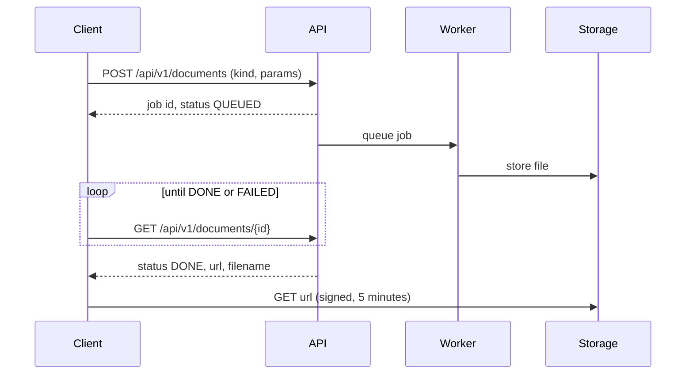

PDFs and Excel files are produced by the worker in the background, not during the request. You ask for a document, poll until it is ready, then download it from a signed link. The web app does exactly this for every **Download** and **Print** button.



## Ask for a document

**Goal:** queue a PDF or Excel file.

**Who can do it:** any signed-in user. Each kind of document checks its own permission when it is queued. For example `invoice-pdf` needs `invoices.view`.

**Steps:**

1. Send the kind and its parameters:

   ```http
   POST /api/v1/documents HTTP/1.1
   Host: api.lims.example.com
   Content-Type: application/json
   Cookie: lims_sid=<session-cookie>
   X-CSRF-Token: <csrf-token>

   {"kind": "invoice-pdf", "params": {"invoiceId": "<invoice-id>"}}
   ```

**Result:** the job, usually still queued:

```json
{ "id": "<job-id>", "kind": "invoice-pdf", "status": "QUEUED", "error": null, "url": null, "filename": null }
```

## Wait for it

Poll the job until its status is `DONE` or `FAILED`:

```http
GET /api/v1/documents/<job-id> HTTP/1.1
Cookie: lims_sid=<session-cookie>
```

| Status | Meaning |
| --- | --- |
| `QUEUED` | Waiting for the worker. |
| `RUNNING` | The worker is producing it. |
| `DONE` | Ready. `url` and `filename` are set. |
| `FAILED` | It could not be produced. `error` says why. |

The web app polls about every 0.7 seconds and gives up after 2 minutes. Most documents take a few seconds.

Only the person who asked for a job can read it. Anyone else gets `403 FORBIDDEN`.

## Download it

When the status is `DONE`, `url` is a **signed link** to the file on the files domain, valid for **5 minutes**:

```json
{
  "id": "<job-id>",
  "kind": "invoice-pdf",
  "status": "DONE",
  "error": null,
  "url": "https://files.lims.example.com/lims/…?X-Amz-Signature=…",
  "filename": "<invoice-number>.pdf"
}
```

Fetch the link with a plain `GET`. It needs no cookie. PDFs and images open in the browser; other files (Excel, Word, CSV) download.

If the link has expired, `GET /api/v1/documents/{id}` again: each call returns a fresh link.

:::tip
In a browser, open the new tab during the click and point it at the link when the job is done. Browsers block tabs opened long after a click.
:::

## When it fails

- **Business errors** (for example "The final PDF is still being prepared") are shown in `error` as they are.
- **Infrastructure errors** are logged on the server and show only "The document could not be produced. Please try again."

The worker tries each document twice before it marks it failed.

## Kinds of document

| Kind | Parameters | Needs |
| --- | --- | --- |
| `quotation-pdf` | `versionId` | `quotations.view` |
| `job-srf` | `jobId` | `customers.view` |
| `job-acknowledgement` | `jobId`, optional `photoIds` | `customers.view` |
| `sample-labels` | `jobId` | `jobs.view` |
| `job-card` | `jobId` | `planning.view` or `tests.viewAll` |
| `test-data` | `sampleTestId` | See the API reference |
| `dispatch-challan` | `dispatchId` | `dispatch.view` |
| `invoice-pdf` | `invoiceId` | `invoices.view` |
| `credit-note-pdf` | `creditNoteId` | `invoices.view` |
| `statement-of-account` | `customerId`, optional `from` and `to` | `invoices.view` |
| `due-invoices-export` | The due invoices filters | `invoices.view`, and a recent password confirmation |
| `customer-export` | The customer list filters | `customers.view`, and a recent password confirmation |
| `master-export:<master>` | The master list filters | The permission to view that master |
| `mis:<report>` | The report's filters, plus `format` (`pdf` or Excel) | The report's own permission |

<!-- TODO(verify): the full parameter list of each document kind, the permission checked by test-data, and the format value for Excel MIS exports. -->

Some kinds belong to a module the lab can turn off: `mis:*` (analytics), invoices, credit notes, statements and due invoices (billing), `quotation-pdf` (quotations) and `dispatch-challan` (dispatch). When the module is off they answer `403 MODULE_OFF`.

The signed report's final PDF and combined letter pages are made only by the server. Asking for them through `POST /api/v1/documents` gives `400 BAD_REQUEST` ("Unknown document type").

## Rules

- **Rate limit:** 30 document requests a minute per user. More gives `429 RATE_LIMITED`.
- **Server-only options:** `params` may not contain `email`, `whatsapp`, `final` or any key starting with `_`. Such a request is refused with `400`, naming each field. Emailing a document is done through each record's own email endpoint.
- **Sensitive exports:** bulk exports of personal or money data (`customer-export`, `due-invoices-export`) need the password confirmed in the last 10 minutes (`403 REAUTH_REQUIRED` otherwise), and administrators are told they happened.
- **Large PDFs:** an MIS report with too many rows for a PDF is refused with `422 TOO_MANY_ROWS`. Export it to Excel instead.

## Related

- [Authentication](/help/developers/authentication/)
- [Errors](/help/developers/errors/)
- [Documents](/help/features/documents/)
