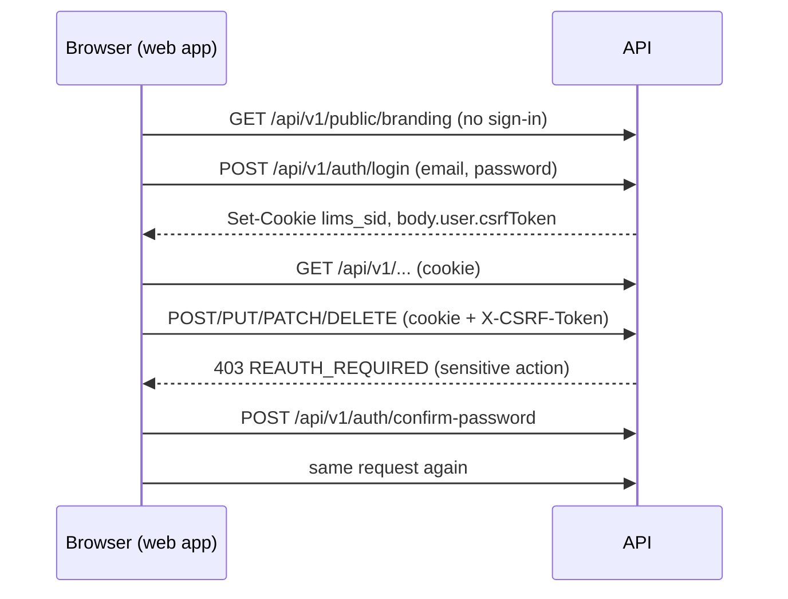

Everything the web app does goes through one REST API. The app holds no business rules of its own: permissions, status changes, calculations, GST, numbering, PDFs and the audit log are all on the server. So anything you can do in the app, an integration can do through the same API, with the same checks.

## Base URL

Every endpoint is under `/api/v1` on the API domain:

```http
GET https://api.lims.example.com/api/v1/auth/me
```

The health checks are the only exception: `GET /health/live` and `GET /health/ready`, with no prefix. See [Operations](/help/install/operations/#health-checks).

## Requests and responses

- Request and response bodies are JSON (`Content-Type: application/json`), except file uploads, which are `multipart/form-data` with one file per request.
- A JSON body may be at most 2 MB. Uploads may be up to `MAX_UPLOAD_BYTES` (15 MB by default).
- Unknown fields in a request body are **refused**, not ignored. You get `400 VALIDATION_FAILED` naming each field. See [Errors](/help/developers/errors/).
- Money is sent and returned as a decimal **string**, for example `"1180.00"`, so no precision is lost. Never add money up on the client; the server returns every total.
- Records you can edit carry a `version` number. Send back the version you read; if someone else saved in between, you get `409 CONFLICT`. See [Errors](/help/developers/errors/#conflicts-and-versions).
- Lists share one shape, `{ data, meta }`, and the same paging parameters. See [Lists and paging](/help/developers/lists-and-paging/).
- Every response carries an `X-Request-Id` header. You may send your own `X-Request-Id` (8 to 64 letters, digits, `_` or `-`); otherwise the server makes one.
- Dates and times are Indian Standard Time (Asia/Kolkata). The currency is INR.

## Authentication in short

The API uses a session cookie and a CSRF token, exactly as the web app does. There are no API keys. Sign in with `POST /api/v1/auth/login`, keep the `lims_sid` cookie, and send the `X-CSRF-Token` header on every request that changes something. See [Authentication](/help/developers/authentication/).

:::note
Browsers may call the API only from the app's own address (`FRONTEND_ORIGIN`); other origins are refused by CORS. Server-to-server integrations are not affected by CORS.
:::

## OpenAPI description

The API is described by an OpenAPI 3 document generated from the code, so it always matches what the server accepts: types, required fields, lengths and allowed values come from the same definitions the server validates with.

- The generated reference is at [API reference](/help/developers/api/).
- Each backend build publishes `openapi.json` as a versioned build artifact, and the backend repository keeps the current file at its root.
- The running server does not serve the document or an interactive explorer.

The web app generates its typed API client from a pinned copy of that same file and fails its build if the client and the file disagree. API types are never written by hand.

## How the web app uses the API



- On load it reads the lab's public branding (name, colours, logo) from `GET /api/v1/public/branding`. Nothing about a lab is built into the app.
- It keeps the CSRF token in memory only and fetches it again from `GET /api/v1/auth/me` after a reload.
- On `401` it sends the person to the sign-in page.
- On `403 REAUTH_REQUIRED` it asks for the password, then repeats the request.
- PDFs and Excel files are produced by background jobs. See [Documents](/help/developers/documents/).

## Areas of the API

| Path | Area |
| --- | --- |
| `/auth` | Sign-in, sessions, passwords, two-factor login |
| `/public` | No sign-in: branding, first-run setup, report verification |
| `/admin` | Users, roles, settings, audit log, lab profile and branding |
| `/masters` | Tests, parameters, methods, specifications, instruments, rates and other masters |
| `/customers` | Customers, contacts, addresses, customer history |
| `/orders`, `/quotations` | Enquiries and quotations |
| `/jobs`, `/samples` | Booking, jobs and samples |
| `/planning`, `/tests` | Planning, assignment and result entry |
| `/reports` | Report drafts, review, approval, issue and revision |
| `/dispatch` | Dispatch, returns and disposal |
| `/invoices`, `/payments` | Invoices, credit notes, payments, due invoices |
| `/mis`, `/dashboard` | MIS reports and dashboards |
| `/documents` | Background PDF and Excel jobs |
| `/files`, `/library` | Attachments and the file library |
| `/quality` | Equipment log, competency, non-conformance and CAPA |
| `/privacy` | Data protection requests and breach log |
| `/whatsapp` | WhatsApp messages |
| `/notifications`, `/search`, `/lookup` | Notifications, global search and scan, GSTIN and PIN code lookup |

The full list of endpoints, with every field, is in the [API reference](/help/developers/api/).

## Versioning and breaking changes

The version is in the path: `/api/v1`. Within `v1`, changes are additive: new endpoints, new optional request fields and new response fields can appear in any release.

Every backend change is compared with the last released contract by an automatic check. The build fails on a breaking change unless that exact change is approved in the same change. The check treats these as breaking:

- an endpoint removed
- a response status code removed
- a parameter removed, or one that becomes required
- a request field removed, made required, or changed in type
- a response field removed or changed in type

Approved breaking changes are listed in the release notes. To stay compatible:

- ignore response fields you do not know;
- do not depend on the order of fields;
- treat error `code` values you do not know as a general failure and show the `message`.

## Limits

| What | Limit |
| --- | --- |
| Sign-in attempts | 10 a minute per network address and email; 30 failed sign-ins per network address in 10 minutes |
| Locked account | 5 failed sign-ins lock an account for 15 minutes |
| Document jobs | 30 a minute per user |
| Page size | At most 200 rows per page |

Going over a rate limit gives `429 RATE_LIMITED`.

## Related

- [Authentication](/help/developers/authentication/)
- [Errors](/help/developers/errors/)
- [API reference](/help/developers/api/)
