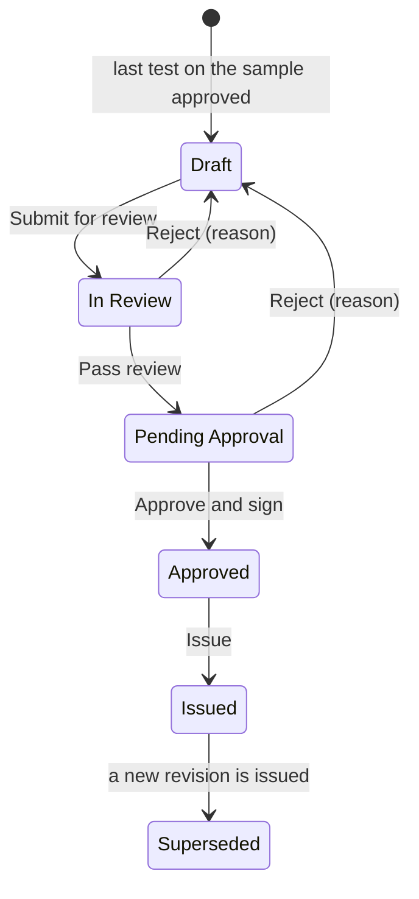

**Approvals** is where results and reports pass their checks. A Head of Department approves each test's results. When every test on a sample is approved, the system creates a draft test report. A Report Reviewer reviews it, an Authorised Signatory approves and signs it with their password, and it is then issued to the customer.

## Who can use it

The **Approvals** menu entry appears for anyone holding at least one of the permissions below. Each tab appears only for its permission.

| Tab | Role | Permission | What it allows |
| --- | --- | --- | --- |
| **Results** | Head of Department | `tests.approve` | Approve or reject submitted test results, one at a time or in bulk. |
| **Review** | Report Reviewer | `reports.review` | Submit drafts for review, correct drafts, pass or reject reports in review. |
| **Sign** | Authorised Signatory | `reports.approve` | Approve and sign, or reject, reports pending approval. Also correct drafts. |
| **Issue** | Authorised Signatory | `reports.issue` | Issue approved reports, email them again, send them on WhatsApp. |
| **Issued** | Report Reviewer, Authorised Signatory, Dispatch, Accounts, Management | `reports.view` | See issued reports and download them. |

Starting a new revision of an issued report needs `reports.revise` (Authorised Signatory). Opening a report page needs `reports.view`. The Admin role holds all of these.

The customer's name appears in lists and on report pages only for people with `customers.view`.

## Where to find it

Select **Approvals** in the left menu. On a phone it is in the bottom bar. **Approvals** and report pages work in full on a phone; lists show as cards, with the first four columns on the card and the rest under **More details**.

Notifications link straight to the right place: "Results to approve" opens the **Results** tab, "Report to review" and "Report to sign" open the report.

<!-- screenshot: approvals-tabs -->

## How a report moves

| Status | Meaning | Who moves it on |
| --- | --- | --- |
| Draft | Created automatically when the last open test on the sample is approved. Can be corrected. Printed with "DRAFT, NOT FOR ISSUE". | `reports.review`: **Submit for review** |
| In Review | Being checked by a reviewer. | `reports.review`: **Pass review** or **Reject** |
| Pending Approval | Waiting for the signatory. | `reports.approve`: **Approve and sign** or **Reject** |
| Approved | Signed. Content is frozen. The final PDF is prepared in the background. | `reports.issue`: **Issue** |
| Issued | Released to the customer. | `reports.revise`: **Revise** starts a new revision |
| Superseded | An older revision replaced by a newer issued one. | Final |

See [Test reports](/help/features/reports/) for what the report contains and how revisions work.

## Approve test results

**Goal:** check an analyst's submitted results and lock them.

**Who can do it:** Head of Department (`tests.approve`).

**Before you start:** the test is Results Submitted. You cannot approve results you entered yourself unless the lab allows it.

**Steps:**

1. Open **Approvals** and the **Results** tab.
2. Select the arrow at the start of a row to show the full results table, with limits and pass or fail.
3. Select **Approve** on the row.
4. In **Approve these results?**, select **Approve**.

**Result:** the toast "… on … approved" appears and the row leaves the list. The test is Approved and locked. When it was the last open test on its sample, a draft report is created and everyone with `reports.review` gets "Report to review".

### The Results list

Urgent tests come first. You can sort by **Test** or **Conducted by** (submission time), search with **Search test, sample or job**, and, if you can see Masters, filter by department with **All departments**.

| Column | What it means |
| --- | --- |
| **Test** | Test code and name (opens the test page), **Urgent** badge, sample, job, due date and a one-line summary of the results. |
| **Overall** | Pass, Fail or No limits. |
| **Conducted by** | The analyst, and when the results were submitted. |
| **Actions** | **Approve** and **Reject**. |

When you entered the results yourself, **Approve** is greyed out with "You entered these results, so someone else must approve them." and the row cannot be selected for bulk approval.

When nothing is waiting, the list shows "No results are waiting for approval".

## Approve several tests at once

**Goal:** approve many routine results in one go.

**Who can do it:** Head of Department (`tests.approve`).

**Steps:**

1. On the **Results** tab, tick the rows to approve.
2. Select **Approve selected**.
3. In **Approve N tests?**, select **Approve selected**.

**Result:** a summary shows how many were approved and lists any that could not be, with the reason for each. Each test is approved on its own, so one failure does not undo the others. Up to 200 tests can be sent at once. **Clear** empties the selection.

## Reject test results

**Goal:** send results back to the analyst for correction.

**Who can do it:** Head of Department (`tests.approve`).

**Steps:**

1. On the **Results** tab, select **Reject** on the row.
2. In **Send these results back**, type the reason (up to 1000 characters).
3. Select **Reject**.

**Result:** the toast "… on … sent back" appears. The test returns to In Progress, the analyst gets a "… was sent back" notification, and the reason shows on their worklist and test page.

## Review a draft report

**Goal:** check a draft report and pass it to the signatory.

**Who can do it:** Report Reviewer (`reports.review`).

**Before you start:** every test on the sample is approved or cancelled.

**Steps:**

1. Open the **Review** tab. It shows two tables: **In review**, and **Draft, not yet submitted for review**.
2. Select a draft report.
3. Check the **Preview** tab. Use **Correct draft** or the **Photos** tab if something needs changing (see below).
4. Select **Submit for review**. The status becomes In Review.
5. When you are satisfied, select **Pass review**.

**Result:** the report becomes Pending Approval, you are recorded as **Reviewed by**, and everyone with `reports.approve` gets "Report to sign".

If a test on the sample is still being re-tested, **Submit for review** is refused with "Some tests are still being re-tested".

## Correct a draft

**Goal:** fix the descriptive details printed on the report before it is signed.

**Who can do it:** Report Reviewer (`reports.review`) or Authorised Signatory (`reports.approve`).

**Before you start:** the report is a Draft. Approved and issued reports are never edited in place.

**Steps:**

1. On the report page, select **Correct draft**.
2. Change the fields (below).
3. Select **Save correction**.

**Result:** the toast "Draft corrected" appears. The change applies to this draft only and is recorded in the history.

| Field | What it means | Required |
| --- | --- | --- |
| **Sample description** | The description printed on the report. | Yes |
| **Customer reference** | The customer's own reference, up to 500 characters. | No |
| **Kind attention** | The person the report is addressed to, up to 200 characters. | No |
| **Report remarks** | Remarks printed on the report under **Report remarks**, up to 4000 characters. | No |

Results themselves cannot be corrected here. To change a result, reject the report and send the test back for re-testing.

## Choose sample photos for the report

**Goal:** print photographs of the sample on the report.

**Who can do it:** Report Reviewer (`reports.review`) or Authorised Signatory (`reports.approve`), while the report is a Draft.

**Steps:**

1. On the report page, open the **Photos** tab. Photos taken at booking are listed with "(taken at booking)".
2. To add more, select **Add photos**, **Take photo** (uses this computer's camera) or **Use phone**.
3. Tick **Print on report** for each photo to print.
4. For each ticked photo, enter a **Caption** (up to 200 characters) and choose a **Print size**: **Small (55 × 40 mm)**, **Medium (85 × 64 mm)**, **Large (120 × 90 mm)** or **Full width (175 × 130 mm)**.
5. Use the up and down arrows to set the order.
6. Select **Save photos**.

**Result:** the toast says how many photos will print on the report. At most 12 photos can be selected. **Undo changes** puts back the last saved choice.

Only photos of this sample can be printed on its report. After a report is approved, the tab shows the photos printed on that revision, read-only. See [Test reports](/help/features/reports/#sample-photographs).

## Reject a report

**Goal:** send a report back for correction or re-testing.

**Who can do it:** Report Reviewer (`reports.review`) when the report is In Review; Authorised Signatory (`reports.approve`) when it is Pending Approval.

**Steps:**

1. On the report page, select **Reject**.
2. Type the **Reason** (whoever corrects or re-tests sees it).
3. Under **What needs to happen**, choose **Correct the report** or **Send tests back for re-testing**.
4. For re-testing, tick the tests under **Tests to send back** (at least one).
5. Select **Reject**.

**Result:** the report returns to Draft and the reviewer is cleared. With re-testing, the chosen tests return to In Progress and their analysts see the reason. Everyone with `reports.review` gets "Report sent back". The report page shows "Rejected at … by …" with the reason until it moves on.

When the re-tested results are approved again, the draft is refreshed with the new results. Corrections, remarks and chosen photos are kept.

## Approve and sign a report

**Goal:** give the report your electronic signature.

**Who can do it:** Authorised Signatory (`reports.approve`).

**Before you start:** the report is Pending Approval, and you did not review it yourself (unless the lab allows the same person to do both).

**Steps:**

1. Open the **Sign** tab and select the report.
2. Check the **Preview**.
3. Select **Approve and sign**.
4. Read "This is your electronic signature." and type **Your password**.
5. Select **Sign and approve**.

**Result:** the toast "Report approved and signed" appears. The report becomes Approved and its content is frozen. The system:

- records your signature with your name, designation and a SHA-256 hash of the report content;
- gives the report a ULR number if the lab works in NABL mode and the report has accredited tests;
- creates the verification code and QR printed on page 1;
- prepares the final PDF in the background. "The final PDF is being prepared. The report can be issued as soon as it is ready." shows until it is done.

If you reviewed the report, **Approve and sign** is greyed out with "You reviewed this report, and the reviewer and signatory must be different people. Another signatory must approve it." A wrong password shows "Incorrect password".

:::note
The wording on the report is "Electronically approved by". The product does not apply a digital certificate.
:::

If the PDF has not appeared after about two minutes, people with `reports.approve` or `reports.issue` see "The PDF is taking longer than usual." with **Prepare it again**. The system also retries by itself every ten minutes.

## Issue a report

**Goal:** release the signed report to the customer, with or without an email.

**Who can do it:** Authorised Signatory (`reports.issue`).

**Before you start:** the report is Approved, its final PDF is ready, and release is not withheld for payment.

**Steps:**

1. Open the **Issue** tab and select the report.
2. Select **Issue**.
3. In **Issue …**, check **Email to (optional)**. It is filled with the job's contact email, or the customer's primary contact, when you hold `customers.view`. Leave it empty to issue without emailing.
4. Add a **Cc** address if needed.
5. Select **Issue report**.

**Result:** the toast "Report issued" or "Report issued and queued for email" appears. The report is Issued. If it is a new revision, the previous issued revision becomes Superseded. When every live sample on the job has an issued report, the job becomes Completed.

| Field | What it means | Required |
| --- | --- | --- |
| **Email to (optional)** | Who receives the report PDF by email. | No |
| **Cc** | A copy address. | No |

:::caution
Once issued, the report can only be changed by a new revision.
:::

If the customer has **Withhold report release until payment is received** ticked, **Issue** is greyed out with "Release is withheld for this customer until payment is received, so this report cannot be issued yet." See [Test reports](/help/features/reports/#withheld-reports).

## Email or WhatsApp an issued report again

**Goal:** send the issued PDF again, for example to a different person.

**Who can do it:** Authorised Signatory (`reports.issue`).

**Steps:**

1. Open the report (the **Issued** tab lists them).
2. Select **Email again**.
3. Enter **Email to** and, if needed, **Cc**.
4. Select **Send**.

**Result:** the toast "Email queued" appears and the **Delivery** tab opens, where you can watch the email's status.

To send on WhatsApp instead, select **WhatsApp** (shown when the WhatsApp module is on). See [WhatsApp](/help/features/whatsapp/).

## Start a revision

**Goal:** correct an issued report.

**Who can do it:** Authorised Signatory (`reports.revise`).

**Steps:**

1. Open the issued report and select **Revise**.
2. Type the reason. It prints on the new revision.
3. Select **Start revision**.

**Result:** the toast "New revision started" appears. A new Draft revision is created and goes through review and approval again. The issued revision stays valid until the new one is issued. See [Test reports](/help/features/reports/#revisions-and-corrections).

## The report page

| Tab | What it shows |
| --- | --- |
| **Preview** | The report as it will print, for any revision chosen in **Revision**. |
| **Photos (n)** | Sample photographs; editable on a draft. |
| **Revisions and tests (n)** | One card per revision with **ULR**, **Reviewed by**, **Approved by**, **Issued**, **PDF SHA-256**, the electronic signature and any rejections, plus **Download revision n**. Then **Tests on this report** with each test's status. |
| **Delivery** | **Email delivery log**: every email of this report and its status. |
| **History** | Every status change and correction, with who, when and why. |

<!-- screenshot: approvals-report-page -->

## Settings that affect approvals

| Setting | Effect |
| --- | --- |
| [`controls.allowSelfApproval`](/help/admin/settings/#controls.allowSelfApproval) | Off by default. When on, a person may approve results they entered. |
| [`controls.allowSameReviewerSignatory`](/help/admin/settings/#controls.allowSameReviewerSignatory) | Off by default. When on, the reviewer may also sign the report. |
| [`report.formatNo`](/help/admin/settings/#report.formatNo), [`report.issueNo`](/help/admin/settings/#report.issueNo), [`report.issueDate`](/help/admin/settings/#report.issueDate), [`report.revisionNo`](/help/admin/settings/#report.revisionNo), [`report.revisionDate`](/help/admin/settings/#report.revisionDate), [`report.samplingStatement`](/help/admin/settings/#report.samplingStatement) | The report format details and sampling statement, frozen onto the report when it is signed. |

NABL mode, the certificate number and the ULR format are part of the lab profile (Admin, Lab profile, **Accreditation**).

## Tips

- Expand a row on the **Results** tab to see every parameter before approving.
- Use bulk approval for routine results; anything that fails is listed with its reason.
- Saved filters on each tab keep your usual search.

## Limitations

- Results cannot be edited from Approvals; send them back instead.
- A draft's results come from the approved tests; only the description, reference, attention, remarks and photos can be corrected.
- The **Review** tab shows its two tables separately, each with its own pages.

## Related

- [My Tests and result entry](/help/features/testing/)
- [Test reports](/help/features/reports/)
- [Email](/help/features/email/)
- [WhatsApp](/help/features/whatsapp/)
- [Notifications](/help/features/notifications/)
