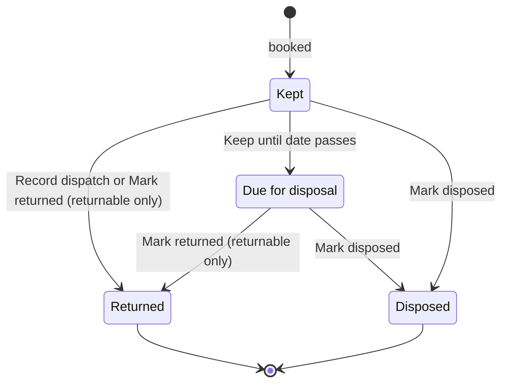

The **Dispatch** screen lists everything that is ready to leave the laboratory, records each dispatch with its mode and courier details, produces a dispatch challan, and keeps track of samples that must go back to the customer or be disposed of when their retention period ends.

:::note
Dispatch is a module. An administrator can turn it off in Admin → Modules. When it is off, the **Dispatch** menu entry disappears and the server refuses dispatch requests. Nothing is deleted: turning it back on brings every record back.
:::

## Who can use it

| Role | Permission | What it allows |
| --- | --- | --- |
| Dispatch, Admin | `dispatch.view` and `dispatch.edit` | See every tab, record dispatches, mark samples returned or disposed |
| Management | `dispatch.view` | See every tab and download challans, but not record anything |

Other details depend on further permissions:

- Customer names show only to people with `customers.view`. Without it, the **Customer** column shows a dash.
- Job numbers link to the job page only for people with `jobs.view`.

## Where to find it

Select **Dispatch** in the left menu. The screen has three tabs: **Pending**, **Dispatches** and **Returnable samples**.

<!-- screenshot: dispatch-pending-tab -->

## What appears on the Pending tab

A job appears on **Pending** when it is not cancelled and it has at least one of:

- an issued report that has not yet gone out on a dispatch, or
- a sample marked **Returnable** at booking that has not yet been returned and is not cancelled.

Each row shows the **Job**, the **Customer**, the **Reports** waiting to go (with the revision number if the report has been revised) and the **Returnable samples**. A report that cannot be released yet shows the badge **Withheld until paid** (see [Withheld reports](#withheld-reports)).

When nothing is waiting, the tab shows **Nothing is waiting to go out**.

## Record a dispatch

**Goal:** record that reports and/or returnable samples for one job have left the lab.

**Who can do it:** Dispatch or Admin (`dispatch.edit`).

**Before you start:** the report must be issued (see [Approvals](/help/features/approvals/)). The job must not be cancelled.

**Steps:**

1. Open **Dispatch** and stay on the **Pending** tab.
2. Find the job. You can type the job number in **Search job**.
3. Select **Record dispatch** on that row.
4. Under **Reports**, tick the reports going out. Every report that is not withheld is ticked for you.
5. Under **Returnable samples**, tick any samples going back to the customer.
6. Check the **Dispatch date**. It starts as today.
7. Choose the **Mode**.
8. If the mode is **Courier**, enter the **Courier name** and the **Docket no.**
9. If the mode is **By hand**, enter the **Carrier name** and the **Carrier contact**.
10. Add **Remarks** if needed.
11. Select **Save dispatch**.

**Result:** the message "Dispatch *number* recorded" appears. The dispatch gets a number from the `DISPATCH` series (for example `LAB/DC/26-27/00012`) and appears on the **Dispatches** tab. The reports and samples you sent leave the **Pending** tab. Each returnable sample you ticked is marked returned, with the dispatch date and the return status "Returned with dispatch".

**Related:** [Reports](/help/features/reports/), [Documents](/help/features/documents/).

<!-- screenshot: dispatch-record-dialog -->

### Record dispatch fields

| Field | What it means | Required |
| --- | --- | --- |
| **Reports** | Issued reports of this job that have not gone out yet. Withheld reports cannot be ticked. | At least one report or one sample |
| **Returnable samples** | Samples of this job marked returnable at booking and not yet returned. | At least one report or one sample |
| **Dispatch date** | The day it left the lab. It also dates the dispatch number. | Yes |
| **Mode** | How it is going. The list comes from the lab's dispatch modes (by default **Courier**, **By hand** and **Post**), kept in Masters. | Yes |
| **Courier name** | The courier company. Shown only for **Courier**. Up to 120 characters. | Yes, for **Courier** |
| **Docket no.** | The courier's tracking or consignment number. Shown only for **Courier**. Up to 120 characters. | Yes, for **Courier** |
| **Carrier name** | The person carrying it. Shown only for **By hand**. Up to 120 characters. | Yes, for **By hand** |
| **Carrier contact** | That person's phone or other contact. Shown only for **By hand**. Up to 60 characters. | Yes, for **By hand** |
| **Remarks** | Anything else to note. It prints on the challan. Up to 1000 characters. | No |

If you tick nothing, the dialog says **Choose at least one report or sample.**

:::caution
A dispatch cannot be edited or deleted after you save it. Check the items and the docket number before you select **Save dispatch**.
:::
<!-- TODO(verify): no edit or delete endpoint exists for a dispatch in the API; confirm this is the intended behaviour and that there is no correction route. -->

## Print the dispatch challan

**Goal:** get the challan that travels with the parcel or is signed by the person collecting it.

**Who can do it:** anyone with `dispatch.view` (Dispatch, Management, Admin).

**Steps:**

1. Open **Dispatch** and select the **Dispatches** tab.
2. Find the dispatch. **Search dispatch, docket or job** searches the dispatch number, the docket number and the job number. You can also filter by **Dispatch date**.
3. Select **Challan** on that row.

**Result:** a PDF named "Dispatch Challan *number*" opens in a new tab. It carries the lab's letterhead, the challan number and date, the job number, the customer's name and report address (the job's report issue address if one was given at booking), the mode with courier, docket, carrier and contact details, a numbered list of items (report or sample, its reference and description), the remarks, and lines for **Dispatched by** and **Received by** signatures.

**Related:** [Documents](/help/features/documents/).

### Dispatches tab columns

| Column | What it shows |
| --- | --- |
| **Dispatch** | The dispatch (challan) number |
| **Date** | The dispatch date |
| **Job** | The job number, linked to the job for people with `jobs.view` |
| **Customer** | The customer's name, for people with `customers.view` |
| **Mode** | The mode as it was named when the dispatch was saved |
| **Courier or carrier** | Courier name, docket, carrier name and contact |
| **Items** | Each report (with `R` and the revision number if revised) and each sample |
| **Challan** | Button that produces the challan PDF |

## Withheld reports

A customer can be set to **Withhold report release until payment is received** (on the customer's record, see [Customers](/help/features/customers/)). For such a customer, the job's reports stay withheld until at least one issued invoice exists for the job and every issued invoice for it is **Paid**. Draft and cancelled invoices do not count.

While a report is withheld:

- it shows **Withheld until paid** on the **Pending** tab;
- in the **Record dispatch** dialog its box cannot be ticked, with the note "Withheld: this customer has report release held until payment is received.";
- the server refuses a dispatch that includes it with "This customer has report release withheld until payment is received".

Returnable samples of the same job can still be dispatched.

**Related:** [Invoices and payments](/help/features/invoices-payments/).

## Returnable samples and disposal

The **Returnable samples** tab tracks samples after testing. Choose which samples to see in the list at the top:

| View | Shows |
| --- | --- |
| **Due back** (default) | Samples marked returnable, not returned yet and not cancelled |
| **Returned** | Samples that went back to the customer, by dispatch or marked by hand |
| **Due for disposal** | Samples neither returned nor disposed whose **Keep until** date has passed |
| **Disposed** | Samples marked disposed |

Each sample's **Keep until** date is set at booking: the booking date plus the lab's sample retention period, [`retention.sampleDays`](/help/admin/settings/#retention.sampleDays) (90 days by default).

The **State** column shows **Disposed**, the return status (for example "Returned to customer"), **Due for disposal**, or the sample's status.

### Mark a sample returned without a dispatch

**Goal:** record that a returnable sample went back to the customer outside a dispatch, for example collected at the counter.

**Who can do it:** Dispatch or Admin (`dispatch.edit`).

**Steps:**

1. Open **Dispatch** and select **Returnable samples**.
2. Find the sample. **Search sample or job** searches the sample and job numbers.
3. Select **Mark returned**.
4. Check the **Date returned**. It starts as today.
5. Check the **Return status**. It starts as "Returned to customer"; change it if needed.
6. Select **Mark returned**.

**Result:** the message "*sample* marked returned" appears and the sample moves to the **Returned** view.

| Field | What it means | Required |
| --- | --- | --- |
| **Date returned** | When it went back | Yes |
| **Return status** | A few words on how it went back, up to 120 characters | Yes |

**Mark returned** appears only for samples marked returnable. A sample that has been disposed of cannot be returned.

### Mark a sample disposed

**Goal:** record that a sample has been disposed of.

**Who can do it:** Dispatch or Admin (`dispatch.edit`).

**Steps:**

1. Open **Dispatch** and select **Returnable samples**.
2. Choose the **Due for disposal** view (or any view that shows the sample).
3. Select **Mark disposed** on the sample.
4. Check the **Date disposed**. It starts as today.
5. Select **Mark disposed** to confirm.

**Result:** the message "*sample* marked disposed" appears and the sample moves to the **Disposed** view.

:::caution
Disposal cannot be undone. A disposed sample cannot be returned to the customer, and a sample that was returned cannot be marked disposed.
:::

## Settings that affect dispatch

| Setting | Effect |
| --- | --- |
| [`retention.sampleDays`](/help/admin/settings/#retention.sampleDays) | How long a sample is kept after booking; sets its **Keep until** date and when it shows as **Due for disposal** |

The dispatch number format is part of the document number formats, [`numbering.formats`](/help/admin/settings/#numbering.formats) (`DISPATCH`, by default `{PREFIX}/DC/{FY}/{SEQ:5}`).

## On a phone

Dispatch works on a phone in a simplified layout. Each table row becomes a card that shows the first four columns, with the rest under **More details**. Search stays at the top; the other filters are under a **Filters** button. The phone's bottom bar shows the four most useful places you can open, in a fixed order (Dashboard, My Tests, Approvals, Samples, Due Invoices, Invoices, Dispatch, …), so **Dispatch** may be there or under **More**. See [Using the app on a phone](/help/guides/on-a-phone/).

## Tips

- Record the dispatch as soon as the parcel is handed over, so the job leaves **Pending** and the docket number is searchable.
- If a report shows **Withheld until paid**, check the job's invoices on [Invoices](/help/features/invoices-payments/) before calling the customer.
- Use saved filters on any tab to keep views you use often.

## Limitations

- A dispatch belongs to one job. Reports from several jobs need one dispatch each.
- A dispatch cannot be edited or deleted once saved.
- Once a report has gone out on a dispatch, a later revision of the same report does not return to **Pending**. Send the revised report by email from the report, or note it in the remarks of another dispatch.
<!-- TODO(verify): Pending tracks dispatched reports by report, not by revision, so an issued revision of an already-dispatched report is not offered again. Confirm with the product owner whether this is intended. -->
- The **Pending** tab looks at the 500 oldest jobs (by received date) that have something to send.

## Related

- [Reports](/help/features/reports/)
- [Jobs and samples](/help/features/jobs-samples/)
- [Customers](/help/features/customers/)
- [Invoices and payments](/help/features/invoices-payments/)
- [Documents](/help/features/documents/)
