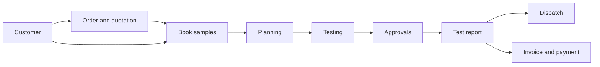

Each page in this section covers one part of the LIMS. It says what the part is for, who may use it, where it is in the menu, and how to do the main tasks. It also lists the form fields, the statuses, and the settings that change how it behaves. To learn your job step by step, start with the guide for your role. Use these pages to look up one screen.

## How work flows through the lab

You can book samples without a quotation. Dispatch and billing work on reports once they are issued.

## All feature pages

| Page | What it covers | Menu entry |
| --- | --- | --- |
| [Customers](/help/features/customers/) | Customers, contacts, addresses with PIN code auto-fill, GSTIN, credit days, history, inactive customers | **Customers** |
| [Orders and quotations](/help/features/orders-quotations/) | Enquiries, quotations and proforma invoices, versions, sending, acceptance and booking | **Orders**, **Quotations** |
| [Book samples](/help/features/booking/) | Booking with or without a quotation, sample photos, deviations, the acknowledgement email | **Samples** |
| [Jobs and samples](/help/features/jobs-samples/) | Job and sample lists, job tabs, editing, holds, cancellations, labels and letters | **Samples** |
| [Planning](/help/features/planning/) | Plans, specifications, assigning technicians and instruments, workload | **Planning** |
| [My Tests and result entry](/help/features/testing/) | Starting a test, stages, results, autosave, calculations, attachments, submitting | **My Tests** |
| [Approvals](/help/features/approvals/) | Result approval, report review, signing with your password, issuing | **Approvals** |
| [Test reports](/help/features/reports/) | Report contents, photos, revisions, withheld reports, ULR, verification QR code | **Approvals** |
| [Dispatch](/help/features/dispatch/) | Pending dispatch, challans, returnable samples, disposal | **Dispatch** |
| [Invoices and payments](/help/features/invoices-payments/) | Ready to invoice, drafts, GST, issuing, payments, advances, credit notes, cancelling | **Invoices** |
| [Due invoices](/help/features/due-invoices/) | Ageing, payment reminders, statement of account | **Due Invoices** |
| [Dashboard and Analytics](/help/features/dashboard-analytics/) | My work, summary tiles, charts and their table views | **Dashboard**, **Analytics** |
| [MIS reports](/help/features/mis-reports/) | Report catalogue, filters, Excel and PDF export | **Reports** |
| [Search and scanning](/help/features/search-scanning/) | Global search, barcode scanners, the phone camera | Search box at the top |
| [Notifications](/help/features/notifications/) | The bell, notification types, email preferences | Bell at the top |
| [Files](/help/features/files/) | The file library, folders, files the system made | **Files** |
| [Quality](/help/features/quality/) | Equipment, competency and training, non-conformance and CAPA, Report a problem | **Quality** |
| [Documents](/help/features/documents/) | Every PDF and Excel file the system produces, and who may produce it | (on each record) |
| [Send photos from your phone](/help/features/phone-upload/) | The **Use phone** QR code and what the phone page does | (on each record) |
| [WhatsApp](/help/features/whatsapp/) | Sending reports, invoices, letters and reminders on WhatsApp, and delivery statuses | (on each record) |
| [Email](/help/features/email/) | Which emails are sent and when, delivery logs, sending again | (on each record) |
| [My account](/help/features/account/) | Password, sessions, notification preferences, access requests, problems you reported | Account menu |
| [On a phone](/help/features/mobile/) | The phone layout and installing the app | |

## What you see depends on your role

The menu shows only the entries your role allows. Each entry needs one of the permissions listed on its page. If you open a page you may not use, you see *You don't have access to this page*. The server applies the same rules whatever screen you use.

## Modules your lab can turn off

An administrator can turn some parts of the LIMS off in Admin → Modules. A module that is off disappears from the menu, its buttons are hidden, and the server refuses its actions. Nothing is deleted: turning it back on brings everything back.

| Module | Pages it covers |
| --- | --- |
| Orders and quotations | [Orders and quotations](/help/features/orders-quotations/) |
| Dispatch | [Dispatch](/help/features/dispatch/) |
| Billing | [Invoices and payments](/help/features/invoices-payments/), [Due invoices](/help/features/due-invoices/) |
| File library | [Files](/help/features/files/) |
| Photos from a phone | [Send photos from your phone](/help/features/phone-upload/) |
| Analytics and MIS reports | [Dashboard and Analytics](/help/features/dashboard-analytics/) (the Analytics part), [MIS reports](/help/features/mis-reports/) |
| Quality management | [Quality](/help/features/quality/) |
| WhatsApp | [WhatsApp](/help/features/whatsapp/) (it also needs the server set up: [WhatsApp setup](/help/integrations/whatsapp/)) |

You cannot turn off the core of the lab's work: customers, booking, planning, testing, approvals, reports, masters and admin.

## Related

- [Settings](/help/admin/settings/)
- [Email templates](/help/admin/email-templates/)
- [Using the LIMS on a phone](/help/guides/on-a-phone/)
