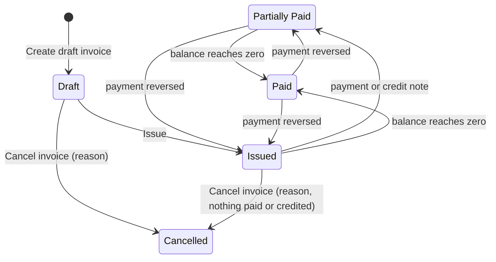

The **Invoices** screen is where Accounts bills the lab's work. Jobs whose tests are approved wait on **Ready to invoice**; you turn them into a draft, check it, and issue it as a numbered GST tax invoice. Payments are recorded against one or more invoices, and anything not allocated is kept as an advance. Mistakes are corrected with credit notes, payment reversals or cancellation, never by deleting.

:::note
Billing is a module. An administrator can turn it off in Admin → Modules. When it is off, **Invoices** and **Due Invoices** disappear from the menu, the server refuses billing requests, and automatic payment reminders pause. Nothing is deleted.
:::

## Who can use it

| Role | Permissions | What it allows |
| --- | --- | --- |
| Accounts, Admin | `invoices.view`, `invoices.edit`, `payments.edit`, `reminders.send` | Everything on this page |
| Management | `invoices.view` | See invoices, payments and amounts; download PDFs |

What each permission allows:

| Permission | Allows |
| --- | --- |
| `invoices.view` | Open **Invoices** and **Due Invoices**, see invoices, payments and amounts, download invoice and credit note PDFs |
| `invoices.edit` | Create drafts, change discounts and rates on drafts, issue, email and cancel invoices, send on WhatsApp |
| `payments.edit` | Record, apply and reverse payments; raise credit notes |
| `reminders.send` | Send payment reminders (see [Due invoices](/help/features/due-invoices/)) |

The customer filter appears only to people who also hold `customers.view`.

## Where to find it

Select **Invoices** in the left menu. The screen has three tabs: **Ready to invoice**, **All invoices** and **Payments**. Selecting an invoice opens its own page.

## Invoice statuses

| Status | Meaning |
| --- | --- |
| **Draft** | Created from jobs; editable; no number yet; nothing sent |
| **Issued** | Numbered, dated, frozen; nothing paid yet |
| **Partially Paid** | Some of the balance is covered by payments or credit notes |
| **Paid** | The balance is zero |
| **Cancelled** | Cancelled with a reason; it no longer counts as billed |

An open invoice past its due date also shows a red **Overdue** badge (on its page, **Overdue by *n* days**). Overdue is worked out from the due date each day; it is not a separate status.

You move an invoice only from **Draft** to **Issued**, and to **Cancelled**. **Partially Paid** and **Paid** follow from the money recorded against it.

## Jobs ready to invoice

A job appears on **Ready to invoice** when it is not cancelled and has a sample with an approved or issued report and at least one approved test that is not yet on an invoice (drafts count; cancelled invoices do not).

| Column | What it shows |
| --- | --- |
| **Job** | Job number, linked to the job |
| **Customer** | The customer |
| **Reports** | Report numbers on the job |
| **Tests** | Approved tests not yet billed |
| **Amount before tax** | Sum of their rates as frozen at booking |
| **Missing rates** | How many tests have no rate yet, or **None** |
| **Received** | When the samples were received |

Rates are frozen at booking: the accepted quotation's rate first, then the customer's rate, then the standard rate. A test booked without any rate is looked up again when you create the draft. If there is still no rate, the draft is refused with "No rate is set for *test* on *sample*. Add one in Masters first."

## Create a draft invoice

**Goal:** turn one or more jobs of one customer into a draft invoice.

**Who can do it:** Accounts or Admin (`invoices.edit`).

**Before you start:** every test to be billed needs a rate (see **Missing rates**).

**Steps:**

1. Open **Invoices**. The **Ready to invoice** tab opens.
2. Tick one job, or several jobs for the same customer. Once you tick one, jobs of other customers cannot be ticked.
3. Select **Create draft invoice**.
4. Check the customer and jobs in the confirmation, then select **Create draft**.

**Result:** the message "Draft invoice created" appears and the draft opens. It has one line per approved test (*sample number* · *test name* (*method*)), the lab's SAC code, the quantity and amount agreed on the quotation (or one unit at the rate), and totals. If all the jobs came from quotations with the same overall discount, that discount is applied.

**Related:** [Orders and quotations](/help/features/orders-quotations/), [Booking](/help/features/booking/).

<!-- screenshot: invoices-payments-ready-to-invoice -->

## Check and adjust a draft

**Goal:** set the discount and notes, and correct a rate, before issuing.

**Who can do it:** Accounts or Admin (`invoices.edit`).

**Steps:**

1. Open the draft invoice. The **Details** tab shows a **Draft** box above the lines.
2. To change the overall discount, enter it in **Discount %**. Leave it empty to keep the current discount.
3. Enter or change **Notes**. Notes print on the invoice.
4. Select **Save draft**.
5. To correct a line's rate, select **Change rate** on that line, enter the **Rate** and a **Reason**, and select **Save rate**.

**Result:** "Draft saved" or "Rate changed" appears and the totals are worked out again by the server. A changed line shows **Override** as its **Rate source**, and the old and new rate are written to the history with your reason.

### Draft fields

| Field | What it means | Required |
| --- | --- | --- |
| **Discount %** | Overall discount on the subtotal, 0 to 100, up to two decimals | No |
| **Notes** | Printed on the invoice, up to 2000 characters | No |

### Change rate fields

| Field | What it means | Required |
| --- | --- | --- |
| **Rate** | New rate per unit, such as 1250.50. The line amount becomes rate × quantity. Cannot be negative. | Yes |
| **Reason** | Why the rate changed, up to 500 characters; kept in the history | Yes |

### Rate source values

| Rate source | Where the rate came from |
| --- | --- |
| **Quotation** | The accepted quotation the job was booked from |
| **Customer Rate** | The customer's own rate in Masters |
| **Standard Rate** | The lab's standard rate in Masters |
| **Override** | Changed on the draft by Accounts |

## How GST is worked out

The server works out every total; the browser never adds money up.

1. **Subtotal** is the sum of the line amounts.
2. **Discount** is the discount percentage of the subtotal.
3. **Taxable amount** is the subtotal less the discount.
4. GST is charged at the lab's GST rate, [`tax.gstRate`](/help/admin/settings/#tax.gstRate) (18% by default):
   - **Intra-state**: when the customer's state (the place of supply) is the lab's state, the invoice shows **CGST** and **SGST**, each at half the rate.
   - **Inter-state**: otherwise it shows **IGST** at the full rate.
5. **Round-off** brings the **Grand total** to the nearest rupee.
6. The amount in words prints under the totals.

The place of supply is the customer's state and GST state code as recorded on the customer. Keep them correct on the customer record (see [Customers](/help/features/customers/)), since they decide CGST/SGST or IGST.

## Issue an invoice

**Goal:** give the invoice its number and date, freeze it, and optionally email it.

**Who can do it:** Accounts or Admin (`invoices.edit`).

**Steps:**

1. Open the draft invoice.
2. Select **Issue**.
3. Leave **Invoice date (optional)** empty to use today, or choose a date.
4. In **Email to (optional)**, the customer's primary contact email is filled in. Leave it empty to issue without emailing.
5. Add a **Cc** if needed.
6. Select **Issue invoice**.

**Result:** "Invoice *number* issued" appears. The invoice gets its number from the `INVOICE` series, its **Due date** (invoice date plus the customer's credit days), and copies of the lab profile, the customer's details and the current invoice terms, so later changes do not alter it. If you gave an email address, the invoice PDF is emailed using the "Tax invoice" template.

| Field | What it means | Required |
| --- | --- | --- |
| **Invoice date (optional)** | Date printed on the invoice; empty means today | No |
| **Email to (optional)** | Who receives the PDF now | No |
| **Cc** | Copy to | No |

:::caution
An issued invoice cannot be edited. To change it, raise a credit note or cancel it and bill again.
:::

<!-- screenshot: invoices-payments-issue-dialog -->

## Download, email or WhatsApp an invoice

**Goal:** send or download an invoice.

**Who can do it:** anyone with `invoices.view` can download the PDF; emailing and WhatsApp need `invoices.edit`.

**Steps:**

1. Open the invoice.
2. Select **PDF** to open the tax invoice. A draft prints "Tax Invoice — DRAFT" and "Not issued".
3. To email an issued invoice, select **Email**, check **Email to** (the primary contact's email is filled in), add a **Cc** if needed, and select **Send**.
4. To send it on WhatsApp, select **WhatsApp**, enter the **WhatsApp number** and **Greeting name**, tick **The customer agreed to receive messages from us on WhatsApp**, and send.

**Result:** "Invoice queued for email" or "Queued for WhatsApp. The PDF is attached once it is ready." appears. The **Delivery** tab lists every email with **To**, **Cc**, **Subject**, **Status**, **Attempts** and **Sent or queued**.

**WhatsApp** appears only when the WhatsApp module is on. See [WhatsApp](/help/features/whatsapp/) and [Email](/help/features/email/).

The invoice PDF shows the letterhead, invoice number, date and due date, place of supply, "Reverse charge: No", the bill-to customer, the services table (S.No, Description, SAC, Qty, Rate, Taxable value), the tax totals, the amount in words, notes, the lab's bank details, a signature block and the invoice terms.

## The invoice page

The header shows the invoice number and status, the customer and CRN (linked for people with `customers.view`), and the buttons you may use. Below it are **Invoice date**, **Due date**, **Place of supply**, **Grand total**, **Paid**, **Credited** and **Balance**.

| Tab | Shows |
| --- | --- |
| **Details** | The draft box (drafts only), the lines with **#**, **Description**, **SAC**, **Qty**, **Rate**, **Rate source**, **Amount**, and the totals |
| **Payments** | Payments allocated to this invoice: **Receipt**, **Date**, **Mode**, **Reference**, **Amount** |
| **Credit notes** | Credit notes against it, with GST split, total, amount in words and a **PDF** button |
| **Reminders** | Reminders sent, with when and whether **Manual** or **Automatic** |
| **Delivery** | Emails sent for this invoice and their status |
| **History** | Every change, who made it, and any reason |

<!-- screenshot: invoices-payments-detail-page -->

## Record a payment

**Goal:** record money received and put it against invoices.

**Who can do it:** Accounts or Admin (`payments.edit`).

**Steps:**

1. Either open an open invoice and select **Record payment**, or open **Invoices** → **Payments** and select **Record payment**.
2. If you started from the **Payments** tab, choose the **Customer**.
3. Check the **Date** and choose the **Mode**.
4. Enter the **Reference** (cheque, UTR or transaction number).
5. Enter the **Amount**. From an invoice, the amount starts as its balance.
6. Under **Allocate to invoices**, enter how much goes to each open invoice. From an invoice, its balance is already entered against it.
7. Add **Notes** if needed.
8. Select **Record payment**.

**Result:** "Payment *receipt number* recorded" appears. If you allocated less than the amount, the message adds "*amount* kept as an advance". Each invoice's balance and status update.

### Record payment fields

| Field | What it means | Required |
| --- | --- | --- |
| **Customer** | Who paid. Fixed when you start from an invoice. | Yes |
| **Date** | When the money was received. It also dates the receipt number. | Yes |
| **Mode** | **NEFT**, **RTGS**, **IMPS**, **UPI**, **Cheque**, **Cash**, **Card** or **Other** | Yes |
| **Reference** | Cheque, UTR or transaction number, up to 200 characters | No |
| **Amount** | Total received, above zero, such as 1250.50 | Yes |
| **Notes** | Internal note, up to 1000 characters | No |
| **Allocate to invoices** | One box per open invoice of this customer (**Invoice**, **Due**, **Balance**, **Allocate**) | No |

The server refuses:

- allocations that add up to more than the payment ("You have allocated more than the payment");
- an allocation above an invoice's balance ("That is more than the balance on *invoice*");
- an allocation to an invoice that is not **Issued** or **Partially Paid**.

<!-- screenshot: invoices-payments-record-payment -->

## Advances

Money not allocated stays on account as an advance. On the **Payments** tab:

- **On account** shows how much of each payment is still unallocated.
- **State** shows **Advance**, **Allocated** or **Reversed**.
- **With money on account** in the filter lists only payments that still hold money.

### Apply an advance

**Goal:** put money held on account against invoices.

**Who can do it:** Accounts or Admin (`payments.edit`).

**Steps:**

1. Open **Invoices** → **Payments**.
2. Select **Apply** on a payment with money on account.
3. Enter amounts against one or more of the customer's open invoices.
4. Select **Apply advance**.

**Result:** "Advance applied, *amount* left on account" appears. You cannot apply more than is left on the payment.

## Reverse a payment

**Goal:** undo a payment recorded by mistake.

**Who can do it:** Accounts or Admin (`payments.edit`).

**Steps:**

1. Open **Invoices** → **Payments**.
2. Select **Reverse** on the payment.
3. Enter the reason.
4. Select **Reverse payment**.

**Result:** "Payment *receipt number* reversed" appears. The payment stays in the list as **Reversed**, and each invoice it paid goes back to its earlier balance and status.

:::note
Payments are never deleted, only reversed, so the receipt numbers have no gaps and the audit trail stays complete.
:::

## Raise a credit note

**Goal:** reduce what the customer owes on an issued invoice, for example after a rate dispute or a cancelled test.

**Who can do it:** Accounts or Admin (`payments.edit`).

**Steps:**

1. Open an issued, partially paid or paid invoice.
2. Select **Credit note**.
3. Enter the **Taxable amount** (before tax).
4. Leave **Date (optional)** empty for today, or choose a date.
5. Enter the **Reason**.
6. Select **Raise credit note**.

**Result:** "Credit note raised" appears. The credit note gets a number from the `CREDIT_NOTE` series. GST is worked out the same way as on the invoice (CGST and SGST, or IGST, at the invoice's rate, rounded to the rupee), and the total reduces the invoice's balance. Select **PDF** on the **Credit notes** tab for the credit note document.

| Field | What it means | Required |
| --- | --- | --- |
| **Taxable amount** | Amount before tax, above zero, such as 1250.50 | Yes |
| **Date (optional)** | Date of the credit note; empty means today | No |
| **Reason** | Printed on the credit note, up to 1000 characters | Yes |

The total with GST cannot be more than the invoice's balance.

## Cancel an invoice

**Goal:** cancel a draft or an issued invoice that should not stand.

**Who can do it:** Accounts or Admin (`invoices.edit`).

**Before you start:** an issued invoice must have no payments and no credit notes against it. Reverse payments first. A credit note cannot be removed, so an invoice with a credit note cannot be cancelled.
<!-- TODO(verify): there is no way to reverse a credit note in the API, so an invoice with any credit note can never be cancelled; confirm this is intended. -->

**Steps:**

1. Open the invoice.
2. Select **Cancel invoice**.
3. Enter the reason.
4. Select **Cancel invoice** to confirm.

**Result:** "Invoice cancelled" appears, the status becomes **Cancelled**, and the page shows "Cancelled: *reason*". Its tests return to **Ready to invoice**, so they can be billed again. A paid invoice cannot be cancelled.

:::caution
Cancelling cannot be undone. An issued invoice keeps its number when cancelled.
:::

## When work is cancelled

If a test, sample or job is cancelled, its lines are removed from any draft invoice and the draft's totals are worked out again. Issued invoices are not changed; correct them with a credit note.

## Settings that affect invoices

| Setting | Effect |
| --- | --- |
| [`tax.gstRate`](/help/admin/settings/#tax.gstRate) | GST rate on drafts and at issue (18% by default) |
| [`credit.defaultDays`](/help/admin/settings/#credit.defaultDays) | Default credit days for customers; the customer's own credit days set each invoice's due date |
| [`numbering.formats`](/help/admin/settings/#numbering.formats) | Number formats for `INVOICE`, `CREDIT_NOTE` and `PAYMENT` (receipts) |
| [`reminders.enabled`](/help/admin/settings/#reminders.enabled) | Automatic payment reminders (see [Due invoices](/help/features/due-invoices/)) |

The email wording is the "Tax invoice" template in Admin → Email templates. See [Email templates](/help/admin/email-templates/).

## On a phone

Invoices work on a phone in a simplified layout. Lists become cards showing the first four columns, with the rest under **More details**, and filters move under a **Filters** button. You can open an invoice, download the PDF, record a payment and send a reminder. See [Using the app on a phone](/help/guides/on-a-phone/).

## Tips

- Use the customer filter on **Ready to invoice** to bill all of one customer's jobs together.
- Check **Missing rates** before selecting jobs; add the rate in Masters first instead of overriding it on every invoice.
- Record payments from the **Payments** tab when one payment covers several invoices.

## Limitations

- One invoice is for one customer. Up to 100 jobs can go on one invoice.
- Only the overall discount, notes and line rates can change on a draft. Lines cannot be added or removed by hand.
- An issued invoice cannot be edited.
- The browser never adds up money: totals and the amount left as an advance come from the server after you save.

## Related

- [Due invoices](/help/features/due-invoices/)
- [Customers](/help/features/customers/)
- [Dispatch](/help/features/dispatch/) (withheld reports)
- [Documents](/help/features/documents/)
- [WhatsApp](/help/features/whatsapp/)
- [Email](/help/features/email/)
