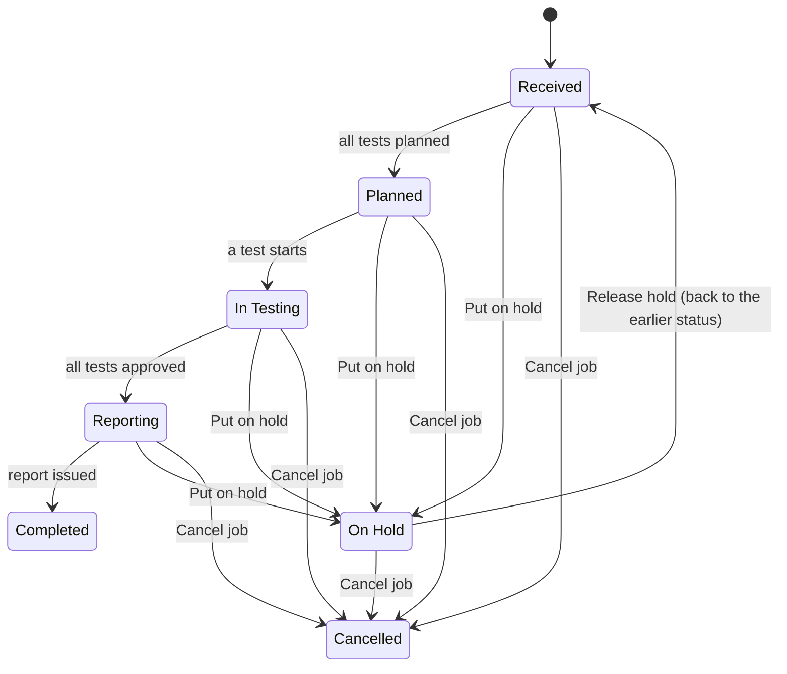

A **job** is one booking from one customer. It holds one or more **samples**, and each sample holds the tests requested on it. This page covers the **Samples** screen (the lists) and the job page that opens from it. Booking a new job is on [Book samples](/help/features/booking/).

## Who can use it

| What you want to do | Permission | Default roles that have it |
| --- | --- | --- |
| See the lists and open a job | `jobs.view` | Sample Reception, Lab Manager / Planner, Sales / Business Development, Report Reviewer, Authorised Signatory, Dispatch, Accounts, Management, Quality Manager, Admin |
| See the customer's name, contacts and references | `customers.view` | Sample Reception, Sales / Business Development, Report Reviewer, Authorised Signatory, Dispatch, Accounts, Management, Admin |
| Edit job and sample details | `jobs.edit` | Sample Reception, Admin |
| Add a deviation, add sample images, send the acknowledgement, add the customer letter | `jobs.create` or `jobs.edit` | Sample Reception, Admin |
| Put a job on hold and release it | `jobs.hold` | Sample Reception, Lab Manager / Planner, Admin |
| Cancel a job or a sample | `jobs.cancel` | Lab Manager / Planner, Admin |
| Cancel a single test | `jobs.cancel` or `planning.edit` | Lab Manager / Planner, Admin |

Admins own the role-to-permission mapping, so your lab may differ.

:::note
Without `customers.view` you work from codes. The lists drop the **Customer** column, the job page hides the customer and the identity fields (letter reference, PO number, contacts, report issue details), and the sample request form and acknowledgement cannot be produced.
:::

## Where it is

**Samples** in the left menu. The screen has two tabs: **Jobs** and **Samples**. Click a row to open the job page. A sample row opens its job with that sample highlighted.

<!-- screenshot: jobs-samples-list -->

## Statuses

A job's status follows its samples, and a sample's status follows its tests. The system moves them as work happens; people only put jobs on hold, release them and cancel them.

| Status | What it means |
| --- | --- |
| **Received** | Booked; not every test is planned yet. |
| **Planned** | Every test on the sample (or every sample on the job) is planned. |
| **In Testing** | At least one test has started. |
| **Reporting** | Every test is approved; the report is being prepared. |
| **Completed** | The report is issued. |
| **On Hold** | A person stopped the job, with a reason (jobs only). |
| **Cancelled** | A person cancelled it, with a reason. |

A job takes the status of its least advanced sample. A sample whose tests are all cancelled no longer holds the job back.

The roll-up can also move back, for example from **Reporting** to **In Testing** when a test is sent back for re-testing.

On the job page, a test that was requested at booking but not yet planned shows **Not planned yet** instead of a status.

## Find a job or sample

1. **Goal**: open the job you need.
2. **Who can do it**: anyone with `jobs.view`.
3. **Steps**:
   1. Open **Samples**.
   2. Choose the **Jobs** tab or the **Samples** tab.
   3. Type in the search box. On **Jobs** it searches the job number or customer (**Search job or customer**); on **Samples** it searches the sample number, description or job (**Search sample, description or job**).
   4. Narrow the list with the filters:
      - **Jobs**: status (**All statuses**), priority (**Any priority**, **Urgent only**, **Not urgent**) and the **Received** date range.
      - **Samples**: status, **Returnable or not** (**Returnable only**, **Not returnable**), priority and the **Received** date range.
   5. Optionally click **Save filter**, give it a **Name** and click **Save**. Saved filters appear as buttons next to the filters.
   6. Click a row.
4. **Result**: the job page opens. If you clicked a sample, the page scrolls to that sample and marks it **Selected**.
5. **Related**: [Search and scanning](/help/features/search-scanning/) (scanning a sample label opens the same page).

### List columns

| Tab | Columns |
| --- | --- |
| **Jobs** | **Job**, **Customer**, **Status**, **Urgent**, **Samples**, **Received**, **Hold reason** |
| **Samples** | **Sample**, **Description**, **Job**, **Customer**, **Status**, **Urgent**, **Returnable**, **Received** |

The filters and the tab are kept in the page address, so a reload or a shared link shows the same list.

## The job page

The header shows the job number, its status, an **Urgent** badge if it is urgent, the customer and customer number (CRN), when it was received and how many samples it has. Notes under the header show the hold reason, the cancellation reason, and the reason it was booked without a quotation, when any of these exist.

Buttons in the header, each shown only to people who may use it:

| Button | What it does | Shown when |
| --- | --- | --- |
| **Report a problem** | Raises a non-conformance about this job. See [Quality](/help/features/quality/). | Quality module on; `tests.work`, `jobs.view` or `quality.view` |
| **Open quotation** | Opens the quotation the job was booked from. | Booked from a quotation; `quotations.view` |
| **Open in planning** | Opens [Planning](/help/features/planning/) filtered to this job. | `planning.view` |
| **Put on hold** | Stops planning and testing. | Job not on hold, cancelled or completed; `jobs.hold` |
| **Release hold** | Returns the job to its earlier status. | Job on hold; `jobs.hold` |
| **Cancel job** | Cancels the job and everything on it. | Job not cancelled or completed; `jobs.cancel` |

The page has five tabs.

<!-- screenshot: jobs-samples-job-detail -->

### Samples tab

One card per sample, with its number, status, a **Returnable** badge, the description, and:

- **Condition**, **Quantity**, **Size**, **Retain until** and any extra attributes.
- **Sample images**: photos of the sample. Add them with **Add file** (PNG or JPEG), **Use camera** (the computer's webcam) or **Use phone** (a QR code; see [Photos from a phone](/help/features/phone-upload/)).
- **Tests**: each requested test with **Test**, **Status**, **Assigned to** and **Due**. People with `tests.viewAll` can click a test to open it.
- Buttons: **Label** (this sample's label), **Edit** and **Cancel sample**, and **Cancel** on each open test.

Below the samples is the **Deviations** card.

**Retain until** is the booking date plus the sample retention period in [`retention.sampleDays`](/help/admin/settings/#retention.sampleDays).

### Job details tab

The job's header fields (see [Edit job details](#edit-job-details)). People without `jobs.edit` see them read-only.

### Documents tab

- **Documents**: **Sample request form**, **Acknowledgement**, **All labels** and, for people with `planning.view` or `tests.viewAll`, **Job card**. Each is produced in the background and opens in a new tab. **Generated files** lists every document produced for this job.
- **Acknowledgement emails**: send the acknowledgement letter and see every email sent for it.
- **Customer letter**: the customer's covering letter, as a scanned PDF or captured pages.

See [Documents](/help/features/documents/) for what each PDF contains.

### Timeline tab

Every status change on the job, its samples and its tests, oldest first, with who made it (or **System**) and any reason. Empty: **Nothing has happened on this job yet**.

### History tab

The audit history of the job: each change with who made it, when, the reason, and the values before and after (under **Changes**). Empty: **No history yet**.

## Edit job details

1. **Goal**: correct or complete the job's header after booking.
2. **Who can do it**: Sample Reception, Admin (`jobs.edit`).
3. **Before you start**: the job must not be **Cancelled** or **Completed**. Otherwise the server answers *This job can no longer be edited*.
4. **Steps**:
   1. Open the job and choose the **Job details** tab.
   2. Change the fields.
   3. Click **Save job details**.
5. **Result**: the toast **Job saved** appears. If you leave the page with unsaved changes, you are asked first.
6. **Related**: [Book samples](/help/features/booking/).

| Field | What it means | Required |
| --- | --- | --- |
| **Letter / challan reference** | The customer's letter or challan number. Up to 200 characters. Needs `customers.view` to see. | No |
| **Letter / challan date** | Date on that letter. | No |
| **Material specification** | The material standard or grade the customer quoted. Up to 500 characters. | No |
| **PO number** | The customer's purchase order. Up to 120 characters. Needs `customers.view`. | No |
| **PO date** | Date of the purchase order. | No |
| **Receipt mode** | How the samples arrived (a list your lab keeps in Masters). | No |
| **Kind attention** | The person the report is addressed to. Needs `customers.view`. | No |
| **Contact email** | Email for this job; used as the default recipient of the acknowledgement. Needs `customers.view`. | No |
| **Contact phone** | Phone for this job. Up to 30 characters. Needs `customers.view`. | No |
| **Report issue details** | How the customer wants the report issued. Up to 1000 characters. Needs `customers.view`. | No |
| **Report issue address** | Address printed on the report, instead of the customer's report address. Up to 1000 characters. Needs `customers.view`. | No |
| **Urgent** | Marks the job urgent. | No |
| **Sample drawn by the laboratory** | Tick when your lab took the sample. The report then leaves out the sampling statement ([`report.samplingStatement`](/help/admin/settings/#report.samplingStatement)). | No |

:::note
Ticking or clearing **Urgent** also changes the urgent flag on every test that is not yet approved or cancelled. Due dates already set at planning are not recalculated.
:::

## Edit a sample

1. **Goal**: correct a sample's description or details.
2. **Who can do it**: Sample Reception, Admin (`jobs.edit`).
3. **Before you start**: the sample must not be **Cancelled** or **Completed** (*This sample can no longer be edited*).
4. **Steps**:
   1. On the **Samples** tab, click **Edit** on the sample's card.
   2. Change the fields. Use **Add attribute** for extra label and value pairs, and the bin icon to remove one.
   3. Click **Save sample**.
5. **Result**: the toast **Sample saved** appears and the card updates.
6. **Related**: [Book samples](/help/features/booking/).

| Field | What it means | Required |
| --- | --- | --- |
| **Description** | What the sample is. Up to 500 characters. | Yes |
| **Condition** | Condition on receipt. Up to 200 characters. | No |
| **Quantity** | How much was received. Up to 120 characters. | No |
| **Size** | Dimensions or size. Up to 120 characters. | No |
| **Returnable** | The customer wants the sample back. It then appears on [Dispatch](/help/features/dispatch/) as a returnable. | No |
| **Attribute *n* label** / **Attribute *n* value** | Extra details, such as heat number. Up to 50 attributes. Both parts are needed for each one. | No |

## Record a deviation

1. **Goal**: record that a sample or the job departs from what was expected (for example, insufficient quantity).
2. **Who can do it**: Sample Reception, Admin (`jobs.edit` or `jobs.create`).
3. **Steps**:
   1. On the **Samples** tab, click **Add deviation** on the **Deviations** card.
   2. Fill in the fields.
   3. Click **Add deviation**.
4. **Result**: the deviation is listed with its type, the sample (or **Whole job**), the remark and the time. Deviations print on the sample request form, the acknowledgement and the test report.
5. **Related**: [Reports](/help/features/reports/).

| Field | What it means | Required |
| --- | --- | --- |
| **Type** | The kind of deviation, from the list your lab keeps in Masters. | Yes |
| **Applies to** | One sample, or **Whole job**. | No (defaults to **Whole job**) |
| **Remark** | Details. Up to 1000 characters. | No |

Deviations cannot be edited or removed from this screen.

## Put a job on hold or release it

1. **Goal**: stop work on a job, for example while waiting for the customer.
2. **Who can do it**: Sample Reception, Lab Manager / Planner, Admin (`jobs.hold`).
3. **Steps**:
   1. Click **Put on hold**.
   2. In **Put this job on hold**, type the reason.
   3. Click **Put on hold**.
4. **Result**: the job shows **On Hold** and the reason. Its tests leave the [Planning](/help/features/planning/) lists, and new plans and assignments on it are refused.

To release it, click **Release hold**, then **Release hold** in **Release the hold?**. The job returns to the status it had before, then catches up with any changes in its tests.

:::note
A reason is required to hold a job (up to 1000 characters). Individual tests can also be held from the test page; see [Testing](/help/features/testing/).
:::

## Cancel a job, sample or test

1. **Goal**: stop work that is no longer wanted, keeping the record.
2. **Who can do it**: Lab Manager / Planner, Admin. A job or sample needs `jobs.cancel`; a single test needs `jobs.cancel` or `planning.edit`.
3. **Steps**:
   1. Click **Cancel job**, **Cancel sample** on a sample card, or **Cancel** on a test row.
   2. The dialog first shows what the cancellation touches: **Samples**, **Tests**, **Reports**, **Lines on draft invoices** and **Lines on issued invoices** (the invoice lines only for people with `invoices.view`). Check it.
   3. Click **Continue**, or **Keep it** to stop.
   4. Type the **Reason for cancelling**.
   5. Click **Confirm cancellation**.
4. **Result**: the toast says it was cancelled. The job, sample or test shows **Cancelled** with the reason, stays visible in lists and reports, and its lines are removed from draft invoices.
5. **Related**: [Invoices and payments](/help/features/invoices-payments/), [Reports](/help/features/reports/).

<!-- screenshot: jobs-samples-cancel-dialog -->

:::caution
Cancelling cannot be undone. The dialog refuses (under **This cannot be cancelled**) when:

- a report on the sample has been approved or issued: revise the report instead;
- the test is already approved, so locked;
- the test is already cancelled.

Lines on issued invoices are not changed; correct them with a credit note.
:::

If someone else changed the record while the dialog was open, you see *This record was changed by someone else. The latest version has been loaded; check the effect again.*

## Print sample labels

1. **Goal**: print a label to stick on each sample.
2. **Who can do it**: anyone with `jobs.view`.
3. **Steps**:
   1. For one sample, click **Label** on its card. For every sample on the job, open the **Documents** tab and click **All labels**.
4. **Result**: a PDF opens in a new tab with one 70 × 40 mm label per page: a QR code of the sample number, the sample number, the job number, the start of the description, the date received, and **URGENT** or **RETURNABLE** where they apply. Cancelled samples are left out. Labels carry no customer name.
5. **Related**: [Search and scanning](/help/features/search-scanning/), [Documents](/help/features/documents/).

## Send the acknowledgement letter

1. **Goal**: tell the customer you have received their samples.
2. **Who can do it**: Sample Reception, Admin (`jobs.create` or `jobs.edit`). Producing the letter also needs `customers.view`.
3. **Before you start**: to include photos, add them under **Sample images** first.
4. **Steps**:
   1. Open the **Documents** tab.
   2. On **Acknowledgement emails**, click **Email acknowledgement**.
   3. Check **To** (filled with the job's contact email) and add a **Cc** if needed.
   4. Under **Photos of the samples as received**, untick any photo you do not want. All are ticked to start with, up to 12.
   5. Optionally click **Preview letter** to see the PDF.
   6. Click **Send**.
5. **Result**: the toast **Acknowledgement queued** appears, then **Preparing the email…** until the email shows in the log with its status.
6. **Related**: [Email](/help/features/email/), [WhatsApp](/help/features/whatsapp/), [Book samples](/help/features/booking/).

| Field | What it means | Required |
| --- | --- | --- |
| **To** | Recipient's email. | Yes |
| **Cc** | One more recipient. | No |
| **Photos of the samples as received** | Photos printed on the letter, two to a row. Only photos of this job's samples can be used. Untick them all to send without photos. | No |

Until an acknowledgement has been emailed, the card shows a reminder: *The customer has not been sent an acknowledgement yet.* The email log has the columns **To**, **Cc**, **Subject**, **Status**, **Attempts** and **Sent or queued**.

The email's wording comes from the samples-received template; see [Email templates](/help/admin/email-templates/).

<!-- screenshot: jobs-samples-acknowledgement-dialog -->

:::tip
Where WhatsApp is set up, use **WhatsApp** on the card, or **Use WhatsApp instead** in the dialog, to send the same letter on WhatsApp. See [WhatsApp](/help/features/whatsapp/).
:::

## Add the customer's letter

1. **Goal**: keep the customer's covering letter with the job.
2. **Who can do it**: Sample Reception, Admin (`jobs.create` or `jobs.edit`).
3. **Steps**:
   1. Open the **Documents** tab and find **Customer letter**.
   2. If you have a scanned PDF, click **Add file** under **Scanned letter (PDF)**.
   3. Otherwise add page images under **Captured pages, in order**, with **Add file**, **Capture pages** (webcam) or **Use phone**.
   4. Click **Combine pages into PDF**.
4. **Result**: the toast **Letter combined into a PDF** appears, the PDF opens in a new tab, and it is listed under **Scanned letter (PDF)**.
5. **Related**: [Photos from a phone](/help/features/phone-upload/), [Files](/help/features/files/).

Only PNG and JPEG pages can be combined, up to 60 pages, in the order they are listed.

## Settings that affect jobs and samples

| Setting | Effect |
| --- | --- |
| [`retention.sampleDays`](/help/admin/settings/#retention.sampleDays) | Sets **Retain until** on new samples. |
| [`controls.impartiality`](/help/admin/settings/#controls.impartiality) | Hides the customer from technicians on test screens and the job card. |
| [`numbering.formats`](/help/admin/settings/#numbering.formats) | Format of job and sample numbers. |

## On a phone

The **Samples** screen and the job page work on a phone in a simplified layout. Lists become cards showing the first four columns, with the rest under **More details**. Filters sit behind a **Filters** button. **Use phone** is not offered on a phone; use **Use camera** or **Add file** instead. See [Using the LIMS on a phone](/help/guides/on-a-phone/).

## Tips

- Open a job straight from a sample label by scanning its QR code.
- **Open in planning** is the quickest way to plan a newly booked job.
- Use the **Timeline** tab to answer "where is this sample?" for a customer.

## Limitations

- A job can only be edited while it is not **Cancelled** or **Completed**.
- Deviations cannot be edited or deleted.
- A cancelled job, sample or test cannot be restored.
- Removing an attached file keeps it in the audit history.

## Related

- [Book samples](/help/features/booking/)
- [Planning](/help/features/planning/)
- [Testing](/help/features/testing/)
- [Documents](/help/features/documents/)
- [Dispatch](/help/features/dispatch/)
