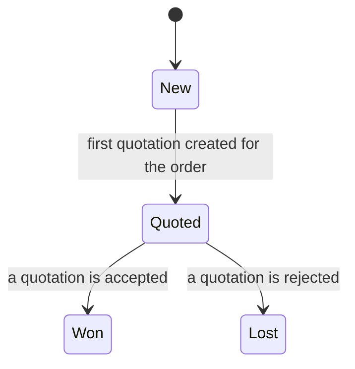
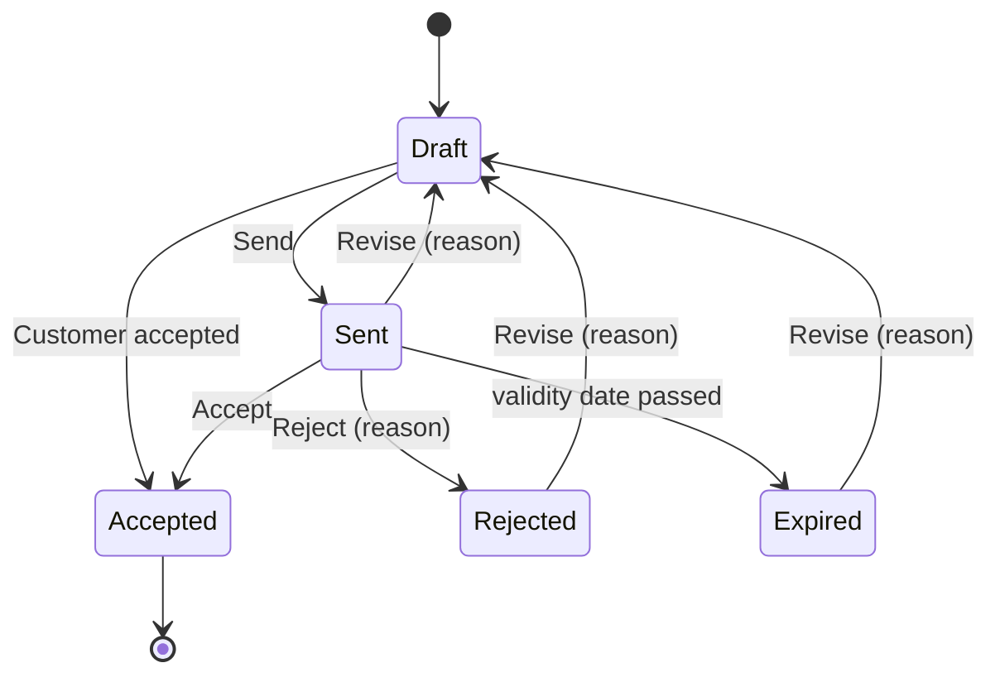

An **order** is an enquiry from a customer: an email, a phone call, a letter or a walk-in. A **quotation** prices the tests the customer asked for. When the customer accepts, the quotation becomes a job in one step, and the agreed prices carry through to the invoice.

Orders and quotations are one module, **Orders and quotations** (`quotations`). An administrator can turn it off in Admin → Modules; the **Orders** and **Quotations** menus and the **Book from an accepted quotation** section then disappear, and nothing is deleted.

## Who can use it

| What | Permission | Default roles |
| --- | --- | --- |
| See orders | `orders.view` | Admin, Sales / Business Development, Management |
| Create and edit orders | `orders.edit` | Admin, Sales / Business Development |
| See quotations | `quotations.view` | Admin, Sales / Business Development, Management |
| Create, edit and revise quotations | `quotations.edit` | Admin, Sales / Business Development |
| Send quotations by email | `quotations.send` | Admin, Sales / Business Development |
| Mark a quotation accepted or rejected | `quotations.decide` | Admin, Sales / Business Development |
| Enter a rate different from the looked-up rate | `quotations.rateOverride` | Admin, Sales / Business Development |
| Convert an accepted quotation to a job | `quotations.convert` | Admin, Sales / Business Development, Sample Reception |

Sample Reception converts accepted quotations from the booking screen without seeing prices. See [Book samples](/help/features/booking/).

## Where to find it

Select **Orders** or **Quotations** in the left menu. On a phone, **Orders** is in the bottom bar or under **More**.

:::note
On a phone, the quotation editor (new and edit) shows **Best on a larger screen**, because a quotation is a table of tests, quantities, rates and discounts. Select **Continue anyway** to use it. Viewing a quotation, sending it and recording the customer's decision work on a phone.
:::

## Orders

### Order stages

An order moves through four stages. The system moves it as its quotations change; you can also set the stage by hand.

The **Orders** list shows a chip for each stage with its count. Select a chip to filter, or **All** to clear it.

### Record an order

**Goal:** log a customer enquiry so it can be quoted and followed up.

**Who can do it:** Admin, Sales / Business Development (`orders.edit`).

**Steps:**

1. In **Orders**, select **New order**.
2. Choose the **Customer**. To add a new one, type the name and choose **Create new customer**.
3. Check **Received on** (today by default) and choose the **Source**.
4. Enter the customer's **Reference** and a **Description** of what they asked for.
5. Choose an **Owner**, or leave **Unassigned**.
6. Select **Save order**.

**Result:** "Order saved" appears and the order opens with its number, for example `LAB/ORD/26-27/00012`. If you left **Owner** empty, you are the owner.

**Related:** [Customers](/help/features/customers/).

<!-- screenshot: orders-new-form -->

### Order fields

| Field | What it means | Required |
| --- | --- | --- |
| **Customer** | Who the enquiry is from. Only active customers are offered. | Yes |
| **Received on** | The date the enquiry came in. | Yes |
| **Source** | **Email**, **Phone**, **Letter** or **Walk In**. | Yes |
| **Reference** | The customer's own reference, such as their enquiry number. Up to 200 characters. | No |
| **Owner** | The person following it up. Only active users who may edit orders are listed. | No |
| **Stage** | **New**, **Quoted**, **Won** or **Lost**. Shown once the order is saved. | No |
| **Description** | What the customer asked for. Up to 2000 characters. | No |

### Work an order

Open an order from the list to see:

- the order form, to change any field and select **Save order**;
- **Quotations** for this order, with **Create quotation** (needs `quotations.edit`), which opens a new quotation with the customer and order filled in;
- **Attachments**, for the customer's enquiry letter or email (upload needs `orders.edit`).

Search the list by order number, customer or reference, and filter by **Received** date. You can save a set of filters to use again.

## Quotations

### Quotation statuses

| Status | Meaning |
| --- | --- |
| **Draft** | Being prepared. Only a draft can be edited. |
| **Sent** | Emailed to the customer. Its content is frozen. |
| **Accepted** | The customer agreed. It can be converted to a job once. |
| **Rejected** | The customer declined. The reason is shown on the quotation. |
| **Expired** | It was sent and its **Valid until** date passed. The system checks every night. |

### Create a quotation

**Goal:** price a customer's tests and save it as a draft.

**Who can do it:** Admin, Sales / Business Development (`quotations.edit`).

**Before you start:** the customer exists, and the tests have rates in Masters (or you can override rates).

**Steps:**

1. In **Quotations**, select **New quotation**. Or, from an order, select **Create quotation**.
2. Choose the **Customer**.
3. Choose the **Order** if this quotation answers one, or leave **No order**.
4. Choose the **Document title**: **Quotation** or **Proforma Invoice**.
5. Fill in the other details as needed. **Contact person** starts as your name, and **Payment terms** start from the customer's credit days.
6. Under **Lines**, enter a **Sample description**, choose the **Test** and set the **Quantity**.
7. Press Enter in a line to start the next one. It keeps the same sample and goes straight to the test. Or select **Add line**.
8. Select **Save draft**.

**Result:** "Draft saved. Totals are updated." appears. The quotation gets its number, for example `LAB/QT/26-27/00031`, and the **Calculated by the server** panel shows each line's rate and amount, and the totals. If the order was **New**, it moves to **Quoted**.

**Related:** [Documents](/help/features/documents/).

<!-- screenshot: orders-quotations-editor -->

:::tip
Rates, tax and totals are worked out by the server when you save, not as you type. Save the draft to see them. If you change something after saving, the panel says the totals are from the last save.
:::

### Quotation fields

| Field | What it means | Required |
| --- | --- | --- |
| **Customer** | Who the quotation is for. Changing it clears **Order**. | Yes |
| **Order** | The enquiry this answers. Only the chosen customer's orders are listed. Needs `orders.view`. | No |
| **Document title** | **Quotation** or **Proforma Invoice**. Printed as the PDF's title. | No (Quotation) |
| **Valid until** | Last day the prices hold. Leave empty for today plus the default validity. | No |
| **Estimated days** | How long testing should take, in whole days (0 to 3650). | No |
| **Contact person** | The lab's contact for this quotation. Starts as your name on a new quotation. | No |
| **Header discount %** | A discount off the subtotal, after line discounts and before tax. 0 to 100. | No |
| **Payment terms** | Printed on the quotation. On a new quotation it starts as "Payment within N days of invoice" from the customer's credit days, or "100% advance" if they have none. | No |
| **Send samples to** | Where the customer should send samples. Leave empty to use the lab address. | No |

### Line fields

A quotation has 1 to 500 lines.

| Field | What it means | Required |
| --- | --- | --- |
| **Sample description** | The sample this test is for. Lines with the same description become one sample when the quotation is converted to a job. | Yes |
| **Required quantity** | How much sample the lab needs, for example "2 pieces, 300 mm". | No |
| **Test** | The test from the test catalogue. | Yes |
| **Quantity** | How many times the test is done. 1 to 10000. | Yes |
| **Rate override** | A rate different from the looked-up rate. Shown only with `quotations.rateOverride`. | No |
| **Override reason** | Why you changed the rate. Required when you enter a rate override. | With an override |
| **Discount %** | A discount on this line. 0 to 100. | No |

### How the rate is chosen

For each line, the server looks up the rate on today's date:

1. the customer's own rate for the test (**Customer Rate**), else
2. the standard rate (**Standard Rate**).

The **Rate source** column shows which was used, or **Override** with the reason. If a test has no rate, saving stops with "No rate is set for … Enter one with a reason, or add a rate in Masters."

A looked-up rate is refreshed every time you save a draft, so a rate changed in Masters reaches drafts. An override is kept.

### Totals and GST

Under the lines you see **Subtotal**, **Discount**, **Taxable amount**, the GST, **Round-off** and **Grand total**.

- If the customer's **GST code** is the same as the lab's, the quotation shows **CGST** and **SGST** (half the rate each).
- Otherwise it shows **IGST** at the full rate.
- The grand total is rounded to the nearest rupee, and the difference is shown as round-off.

### Edit a draft

**Goal:** change a quotation that has not been sent or accepted.

**Who can do it:** Admin, Sales / Business Development (`quotations.edit`).

**Steps:**

1. Open the quotation and select **Edit**.
2. Make your changes.
3. Select **Save draft**.

**Result:** the draft is updated and the totals are recalculated. Select **Open quotation** to go back to its page.

A quotation that is not a draft cannot be edited. Opening its edit page shows "Only a draft can be edited" with a link to revise it instead.

### Send a quotation

**Goal:** email the quotation PDF to the customer.

**Who can do it:** Admin, Sales / Business Development (`quotations.send`).

**Before you start:** the **Valid until** date has not passed.

**Steps:**

1. Open the quotation and select **Send**.
2. Check **To**. It starts with the customer's primary contact email (or the first contact with an email) if you may see customers.
3. Add a **Cc** and a **Message** if you want.
4. Select **Send**.

**Result:** "Quotation queued for sending" appears and the status changes to **Sent**. The PDF of the current version is attached and the email goes out in the background. The **Sent** tab shows the email with its delivery status.

**Related:** [Email](/help/features/email/), [Email templates](/help/admin/email-templates/).

| Field | What it means | Required |
| --- | --- | --- |
| **To** | One email address. | Yes |
| **Cc** | One more email address. | No |
| **Message** | A note added to the email. Up to 2000 characters. | No |

When you send, the customer's details, the lab's details and the current quotation terms and conditions are frozen on that version. Its PDF never changes afterwards.

To send the same version again, for example to another person, select **Send again**. The quotation stays **Sent** and keeps its frozen version.

:::caution
If the validity date has passed, sending stops with "The validity date has passed. Change it before sending." Edit the draft and change **Valid until** first.
:::

### Record the customer's decision

**Goal:** record that the customer accepted or rejected the quotation.

**Who can do it:** Admin, Sales / Business Development (`quotations.decide`).

**Steps (accepted after sending):**

1. Open the quotation and select **Accept**.
2. Confirm with **Accept**.

**Steps (accepted on the phone or at the counter, before sending):**

1. Open the draft and select **Customer accepted**.
2. Confirm with **Accept**. Nothing is emailed; the prices and terms are frozen as if it had been sent.

**Steps (rejected):**

1. Open the sent quotation and select **Reject**.
2. Enter the reason and select **Reject**.

**Result:** the status changes to **Accepted** or **Rejected**. If the quotation belongs to an order, the order moves to **Won** or **Lost**.

A quotation past its **Valid until** date cannot be accepted: "This quotation expired on … Revise it to accept."

### Revise a quotation

**Goal:** change a quotation that has been sent, rejected or has expired.

**Who can do it:** Admin, Sales / Business Development (`quotations.edit`).

**Steps:**

1. Open the quotation and select **Revise**.
2. Enter the reason for the revision and select **Revise**.
3. Select **Edit**, make your changes, and select **Save draft**.
4. Send it again.

**Result:** a new version is created as a **Draft**, copied from the previous one. The reason is shown on the version as its **Revision note**. Earlier versions stay exactly as they were.

An accepted quotation cannot be revised.

### Versions and history

A quotation page has four tabs:

| Tab | Shows |
| --- | --- |
| **Current version** | The current version's terms, lines and totals, with a **PDF** button. |
| **Version history** | Each earlier version with its revision note and its own **PDF** button. |
| **Sent** | Every email sent for this quotation: **To**, **Cc**, **Subject**, **Status**, **Attempts** and **Sent or queued**. It refreshes while an email is queued. |
| **Status history** | Each status change, who made it, when, and any reason. |

<!-- screenshot: orders-quotations-detail -->

### Proforma invoice

A proforma invoice is a quotation with the **Document title** set to **Proforma Invoice**. It follows exactly the same steps and statuses, and its PDF and email use the title "Proforma Invoice". It is not a tax invoice. For tax invoices, see [Invoices and payments](/help/features/invoices-payments/).

### Convert an accepted quotation to a job

**Goal:** create the job once the customer's samples arrive.

**Who can do it:** Admin, Sales / Business Development, Sample Reception (`quotations.convert`).

**Steps:**

1. Open the accepted quotation and select **Convert to job**.
2. Confirm with **Convert to job**.

**Result:** "Job … created" appears and the new job opens. Each distinct **Sample description** becomes one sample, with its tests. Each test carries the quantity and the agreed amount (after line discount) from the quotation, so the invoice bills exactly what was accepted. The quotation then shows **Open job**.

Sample Reception does the same from **Samples** → **Book samples** → **Book from an accepted quotation**. See [Book samples](/help/features/booking/).

:::caution
A quotation can be converted only once. A second attempt is refused with "This quotation has already been converted".
:::

## The quotation PDF

The **PDF** button produces the version's PDF with the lab's letterhead, the customer block, **Tests and rates** (sample, test, method, SAC, quantity, rate, discount, amount), the tax totals, **Payment terms**, **Contact person**, **Estimated duration**, **Send samples to**, the lab's bank details, and the quotation **Terms and conditions**. Anyone with `quotations.view` can download it.

The terms and conditions are kept in Admin → Terms. A sent or accepted version keeps the terms it was frozen with.

## Settings that affect quotations

- [`quotation.defaultValidityDays`](/help/admin/settings/#quotation.defaultValidityDays): used for **Valid until** when you leave it empty (default 30 days).
- [`quotation.defaultPaymentTerms`](/help/admin/settings/#quotation.defaultPaymentTerms): used when **Payment terms** is left empty.
- [`quotation.defaultTitle`](/help/admin/settings/#quotation.defaultTitle): the title used when none is given. The editor always sends the **Document title** you choose, starting from **Quotation**. <!-- TODO(verify): confirm whether the editor should start Document title from quotation.defaultTitle; today it always starts at Quotation -->
- [`tax.gstRate`](/help/admin/settings/#tax.gstRate): the GST rate applied (default 18%).
- [`numbering.formats`](/help/admin/settings/#numbering.formats): the format of order and quotation numbers. Both restart each financial year.

## Tips

- Use the same **Sample description** on every line for one sample. The conversion groups lines into samples by that text.
- A customer who agrees on the phone does not need an email first: use **Customer accepted** on the draft.
- Keep rates in Masters up to date so you rarely need an override.

## Limitations

- Quotations cannot be deleted. Reject or let them expire.
- Only the expiry of **Sent** quotations is automatic. A draft past its validity date stays a draft.
- A quotation is sent to one **To** address and one **Cc** address.
- Quotations are not sent on WhatsApp.

## Related

- [Customers](/help/features/customers/)
- [Book samples](/help/features/booking/)
- [Jobs and samples](/help/features/jobs-samples/)
- [Invoices and payments](/help/features/invoices-payments/)
- [Email](/help/features/email/)
