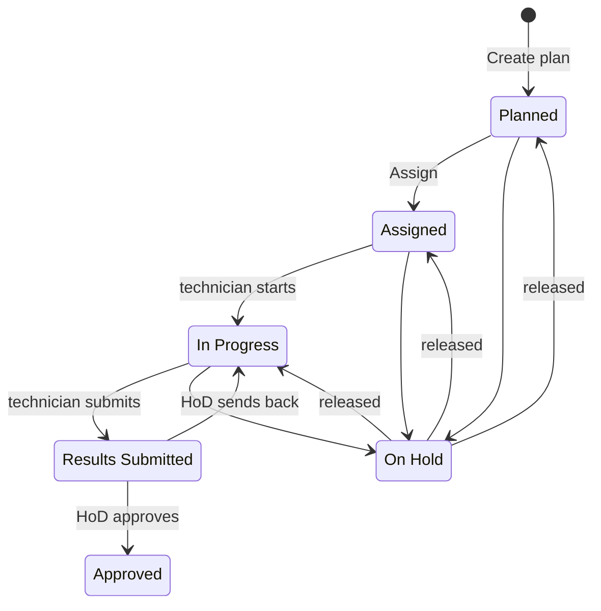

Planning turns the tests requested at booking into work for the bench. You choose the samples, the grade or specification their results are checked against, and the tests to run; then you assign each test to a technician and, optionally, an instrument.

## Who can use it

| What you want to do | Permission | Default roles that have it |
| --- | --- | --- |
| See the planning lists and workload | `planning.view` | Lab Manager / Planner, Management, Admin |
| Plan, assign and reassign tests | `planning.edit` | Lab Manager / Planner, Admin |
| Cancel a test from the list | `jobs.cancel` or `planning.edit` | Lab Manager / Planner, Admin |
| Print the job card | `planning.view` or `tests.viewAll` | Lab Manager / Planner, Head of Department, Report Reviewer, Authorised Signatory, Management, Quality Manager, Admin |

Only people whose role includes `tests.work` (by default, Technician / Analyst) can be assigned tests.

## Where it is

**Planning** in the left menu. From a job page, **Open in planning** opens it filtered to that job.

<!-- screenshot: planning-unplanned -->

## The three lists

| Tab | What it lists |
| --- | --- |
| **Unplanned** | Tests requested at booking that are not yet planned. |
| **Unassigned** | Planned tests with no technician yet (status **Planned**). |
| **Assigned** | Tests with a technician: **Assigned**, **In Progress** or **On Hold**. |

Columns: **Sample**, **Description**, **Job** (a link to the job page), **Test**, **Method**, **Status** (**Not planned yet** on the **Unplanned** tab), **Urgent**, **Due**, **Assigned to**, **Instrument**, and **Cancel** for people who may cancel tests. Urgent tests come first.

Filter with the search box (**Search test, sample or job**), the job filter (**All jobs**), the department filter (**All departments**), and **Save filter**.

Tests on jobs that are **On Hold** or **Cancelled**, and cancelled samples and tests, are not listed.

Empty lists say **No tests waiting to be planned**, **No planned tests waiting for a technician** or **No tests are assigned**.

## Test statuses

Any test that is not approved can also be **Cancelled**, with a reason. An approved test is locked; only a report rejection that sends it back for re-testing reopens it. Testing and approval are covered on [Testing](/help/features/testing/) and [Approvals](/help/features/approvals/).

## Plan tests

1. **Goal**: create a plan for one or more samples of a job, with the tests to run.
2. **Who can do it**: Lab Manager / Planner, Admin (`planning.edit`).
3. **Before you start**: the job must not be **On Hold**, **Cancelled** or **Completed**. Each test must have parameters in Masters.
4. **Steps**:
   1. On the **Unplanned** tab, tick the tests to plan. They must all be from one job; otherwise you see *Plan samples from one job at a time.*
   2. Click **Plan**. Or, with a job chosen in the job filter, click **Plan samples** at the top to plan that job from scratch.
   3. In **Plan samples on** *job number*, check the **Samples** ticked.
   4. Optionally choose a **Grade / specification**, a **Second grade (dual grade)** and a **Test or chemical group**, then click **Suggest tests** to add the tests they cover.
   5. Add any other test with **Add a test…**. Remove one with its bin icon.
   6. For each test, fill in the details (see the table). Choose **Assign to** now, or leave it at **Later**.
   7. Add **Plan notes** if needed.
   8. Click **Create plan**.
5. **Result**: the toast *Plan* *number* *created with* *n* *tests* appears. Tests with a technician move to **Assigned** and the technician is notified; the rest wait on **Unassigned**. The job moves to **Planned** once every test on it is planned.
6. **Related**: [Jobs and samples](/help/features/jobs-samples/), [Testing](/help/features/testing/).

<!-- screenshot: planning-plan-dialog -->

| Field | What it means | Required |
| --- | --- | --- |
| **Samples** | The samples of this job the plan covers. Cancelled samples are not offered. | Yes (at least one) |
| **Grade / specification** | The grade results are checked against. Its limits are copied onto each result when the plan is created. | No |
| **Second grade (dual grade)** | A second grade to check against as well. Must differ from the first. | No |
| **Test or chemical group** | A group of tests from Masters; use **Suggest tests** to add them. | No |
| **Analysis mode** | **Spectro** or **Wet**. Shown for chemical tests only. | No |
| **Office instructions** | Instructions shown to the technician. Up to 2000 characters. | No |
| **Technical data** | Sample details for the technician. Up to 4000 characters. | No |
| **Assign to** | The technician, with their open tests in brackets. **Later** leaves the test on **Unassigned**. | No |
| **Instrument** | The instrument to use. Overdue instruments say *(calibration overdue)*. | No |
| **Plan notes** | Notes on the plan. Up to 2000 characters. | No |

Each test card also lists its **Parameters**. A test without parameters says *This test has no parameters. Add them in Masters before planning.*, and creating the plan is refused.

### What planning sets

- **Plan number** from the plan number series ([`numbering.formats`](/help/admin/settings/#numbering.formats)).
- **Due date**: today plus the test's turnaround time in working days (its urgent turnaround if the job is urgent), skipping non-working days ([`calendar.workingDays`](/help/admin/settings/#calendar.workingDays)) and the holidays in Admin → Holidays.
- **Stages**: the test's stages from Masters, or a single **Analysis** stage if it has none.
- **Limits and accreditation**: copied onto each result, so later changes in Masters do not alter this test.

A test that is already planned on a sample is refused (*… is already planned on …*). A test added in the plan that was not requested at booking is added to the sample at the customer's rate, or the standard rate if there is none.

## Assign or reassign tests

1. **Goal**: give planned tests to a technician, or move them to another.
2. **Who can do it**: Lab Manager / Planner, Admin (`planning.edit`).
3. **Steps**:
   1. Open **Unassigned** to assign, or **Assigned** to reassign.
   2. Tick the tests.
   3. Click **Assign** (or **Reassign**).
   4. Under **Technician**, choose one person. The table shows each person's current work: **Open**, **In progress**, **Overdue**, **Urgent**.
   5. Under **Instrument (optional)**, choose an instrument, or **No instrument** (**Keep the current instrument** when reassigning). The table shows **Calibration due** and the same work counts.
   6. Click **Assign** (or **Reassign**).
4. **Result**: the toast *n tests assigned* (or *reassigned*) appears. The technician is notified and sees the tests in **My Tests**. Reassigning keeps each test's status.
5. **Related**: [Testing](/help/features/testing/), [Notifications](/help/features/notifications/).

<!-- screenshot: planning-assign-dialog -->

The assignment is all or nothing: if one test cannot be assigned, none are. It is refused when:

- the person cannot be assigned tests (*That person cannot be assigned tests*);
- the instrument is inactive (*That instrument is not available*);
- the job is on hold or cancelled (*This job is not active*);
- the test is not planned yet, or is already submitted, approved or cancelled;
- someone changed the test since you loaded the list (reload and try again).

### Authorisation warning

When the Quality module is on, the dialog checks whether the chosen technician is authorised for each test (Quality → Competency). If not, it warns:

> *Name* is not authorised for *test*. You can still assign; consider authorising them in Quality, Competency.

If your lab turns on [`controls.requireAuthorisation`](/help/admin/settings/#controls.requireAuthorisation), the warning turns red (*Your lab requires authorisation, so this assignment will be refused.*) and the server refuses the assignment. See [Quality](/help/features/quality/).

### Overdue instruments

An instrument past its calibration due date is marked **Calibration overdue**, and choosing it shows *… is overdue for calibration.* Planning still allows it. If your lab turns on [`controls.blockOverdueInstruments`](/help/admin/settings/#controls.blockOverdueInstruments), the technician cannot use an overdue instrument when working the test (see [Testing](/help/features/testing/)).
<!-- TODO(verify): blockOverdueInstruments is enforced in the testing service (assertInstrument), not when planning or assigning; DECISIONS.md says an overdue instrument "can't be planned". Confirm the intended behaviour. -->

## Cancel a test

1. **Goal**: drop a test that is no longer needed.
2. **Who can do it**: Lab Manager / Planner, Admin (`jobs.cancel` or `planning.edit`).
3. **Steps**:
   1. Click **Cancel** on the test's row.
   2. Check the effect, click **Continue**, type the **Reason for cancelling** and click **Confirm cancellation**.
4. **Result**: the test shows **Cancelled** and drops out of the lists and draft invoices.
5. **Related**: [Jobs and samples](/help/features/jobs-samples/#cancel-a-job-sample-or-test).

## Print the job card

1. **Goal**: give the bench a printed sheet of the planned tests.
2. **Who can do it**: anyone with `planning.view` or `tests.viewAll`.
3. **Steps**:
   1. Choose a job in the job filter and click **Job card** at the top. Or tick tests from one job on **Unassigned** or **Assigned** and click **Job card**.
4. **Result**: a PDF opens with one box per planned test: test, due date, urgency, sample, method, analyst, instrument, analysis mode, office instructions, technical data, parameters, and a blank row of stages to sign off.
5. **Related**: [Documents](/help/features/documents/).

The job card shows the customer's name only when [`controls.impartiality`](/help/admin/settings/#controls.impartiality) is off. It never shows prices.

## Settings that affect planning

| Setting | Effect |
| --- | --- |
| [`controls.requireAuthorisation`](/help/admin/settings/#controls.requireAuthorisation) | Refuse to assign a test to someone not authorised for it. Off by default (a warning only). |
| [`controls.blockOverdueInstruments`](/help/admin/settings/#controls.blockOverdueInstruments) | Block instruments past their calibration due date when the test is worked. |
| [`calendar.workingDays`](/help/admin/settings/#calendar.workingDays) | Working days used for due dates. |
| [`controls.impartiality`](/help/admin/settings/#controls.impartiality) | Hides the customer on the job card. |
| [`numbering.formats`](/help/admin/settings/#numbering.formats) | Format of plan numbers. |

## On a phone

Planning is desktop-only. On a phone it shows **Best on a larger screen**, with **Email me the link**, **Copy link** and **Continue anyway** to open it regardless. See [Using the LIMS on a phone](/help/guides/on-a-phone/).

## Tips

- Pick a grade and click **Suggest tests**: it adds every test with a limit in that grade.
- The numbers in **Assign to** (*n open*) help spread the work without opening the assign dialog.
- Plan a sample booked without requested tests with **Plan samples** after choosing its job in the filter.

## Limitations

- One plan covers samples from one job only.
- A plan's grade applies to every sample in it; plan samples with different grades separately.
- Due dates are set when the test is planned and are not recalculated if the job's urgency changes later.
- Planning cannot unassign a test from this screen; reassign it instead.
<!-- TODO(verify): the workflow allows Assigned → Planned with planning.edit, but no UI or endpoint for unassigning was found. -->

## Related

- [Jobs and samples](/help/features/jobs-samples/)
- [Testing](/help/features/testing/)
- [Quality](/help/features/quality/)
- [Documents](/help/features/documents/)
