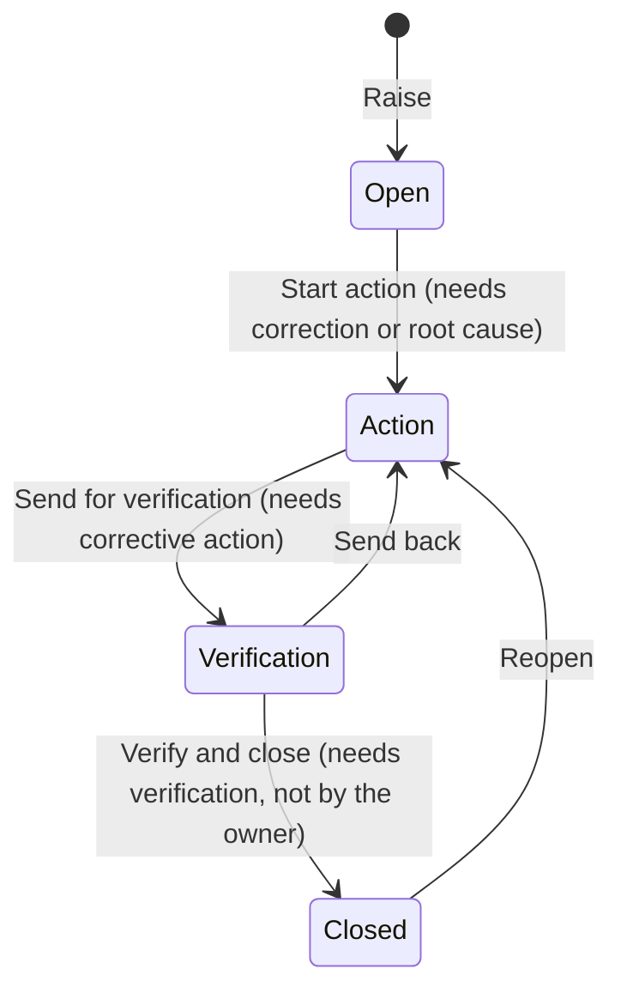

The **Quality** section holds the records an ISO/IEC 17025 laboratory keeps alongside its testing: the equipment log (calibration, checks, maintenance), staff competency (authorisations and training), and the non-conformance and CAPA register. Anyone at the bench or front desk can also raise a problem from a test or job page with **Report a problem**.

:::note
Quality management is a module. An administrator can turn it off in Admin → Modules. When it is off, the **Quality** menu, **Report a problem** and **Problems I reported** are hidden, and the server refuses quality requests. Nothing is deleted.
:::

## Who can use it

| What | Permission | Default roles |
| --- | --- | --- |
| Open **Quality**, see equipment, authorisations, training and non-conformances | `quality.view` | Quality Manager, Admin, Management, Lab Manager / Planner, Head of Department |
| Record calibration and maintenance, change schedules, authorise and withdraw, record training, work non-conformances | `quality.manage` | Quality Manager, Admin |
| Raise a non-conformance (**Report a problem**, or **Raise a non-conformance** on the Quality page) and see **Problems I reported** | `quality.view`, `tests.work` or `jobs.view` | Everyone who works on tests or jobs |

## Where to find it

**Quality** in the left menu. The page has four tabs: **Overview**, **Equipment**, **Competency** and **Non-conformance**.

On a phone the Quality page opens normally; tables show as cards. See [On a phone](/help/features/mobile/).

<!-- screenshot: quality-overview -->

## Overview

The **Overview** tab shows five tiles. Select a tile to open the tab it counts.

| Tile | What it counts |
| --- | --- |
| **Equipment overdue** | Active instruments whose calibration or maintenance due date has passed |
| **Equipment due soon** | Instruments due within the warning period ([`quality.dueWarningDays`](/help/admin/settings/#quality.dueWarningDays), 15 days by default) |
| **Authorisations expiring soon** | Active authorisations whose **Valid until** date falls within the same warning period |
| **Non-conformances open** | Every non-conformance that is not **Closed** |
| **Non-conformances overdue** | Open non-conformances past their **Due** date |

## Equipment

The **Equipment** tab lists every active instrument from Masters, with **Instrument**, **Department**, **Calibration due**, **Maintenance due** and **Status**. Overdue instruments come first.

| Status | Meaning |
| --- | --- |
| **Overdue** | The earlier of the calibration and maintenance due dates has passed |
| **Due soon** | Due within [`quality.dueWarningDays`](/help/admin/settings/#quality.dueWarningDays) days |
| **In date** | Both dates are further away |
| **Not scheduled** | The instrument has no calibration or maintenance due date |

If the list is empty, it says **No instruments yet**: add instruments in Masters first.

Every morning at 08:00 (Indian time), holders of `quality.manage` get one notification listing instruments that are overdue or due soon. See [Notifications](/help/features/notifications/).

### Record calibration or maintenance

**Goal:** log work done on an instrument and move its next due date.

**Who can do it:** Quality Manager, Admin (`quality.manage`).

**Steps**

1. Open **Quality**, then the **Equipment** tab.
2. On the instrument's row, select **Record**.
3. Choose **What was done**: **Calibration**, **Intermediate check**, **Maintenance**, **Repair** or **Breakdown**.
4. Choose the **Outcome**: **Pass**, **Adjusted, then passed** or **Fail**.
5. Fill in **Date done** and **Done by**, and the other fields you need.
6. Select **Record**.

**Result:** the toast says "Recorded. The due dates are updated." The row's due dates and status change.

<!-- screenshot: quality-record-equipment-work -->

| Field | What it means | Required |
| --- | --- | --- |
| **What was done** | Calibration, Intermediate check, Maintenance, Repair or Breakdown | Yes |
| **Outcome** | Pass, Adjusted then passed, or Fail | Yes |
| **Date done** | The day the work was done. It cannot be in the future. | Yes |
| **Done by** | The agency or person who did it (up to 200 characters) | Yes |
| **Certificate no.** | The calibration certificate number (up to 100 characters) | No |
| **Next due** | When it is next due. Must be after **Date done**. If empty, a calibration or maintenance uses the instrument's interval (the hint shows "Empty: N months from the date done"). | No |
| **Notes** | Anything else (up to 2000 characters) | No |

How each kind of work changes the instrument:

- A **Calibration** that passes (or was adjusted) sets the last calibration date and the next calibration due date.
- A **Maintenance** that passes (or was adjusted) sets the last maintenance date and the next maintenance due date.
- A **Calibration** that fails, or any **Breakdown**, sets the calibration due date to the date done, so the instrument shows **Overdue** until a calibration passes.
- An **Intermediate check** or **Repair** is recorded in the history but does not move a due date.

:::caution
Where the lab has turned on [`controls.blockOverdueInstruments`](/help/admin/settings/#controls.blockOverdueInstruments), a technician cannot choose an instrument that is past its calibration due date on a test. A failed calibration or a breakdown therefore takes the instrument out of use straight away.
:::

### Set the calibration and maintenance intervals

**Goal:** make each recorded calibration or maintenance set the next due date automatically.

**Who can do it:** Quality Manager, Admin (`quality.manage`).

**Steps**

1. On the **Equipment** tab, select **Schedule** on the instrument's row.
2. Fill in the intervals and, if you know it, the next maintenance date.
3. Select **Save schedule**.

**Result:** the toast says "Schedule saved".

| Field | What it means | Required |
| --- | --- | --- |
| **Calibrate every (months)** | Interval used when a calibration is recorded without a **Next due** date (1 to 120) | No |
| **Maintain every (months)** | Interval used when maintenance is recorded without a **Next due** date (1 to 120) | No |
| **Next maintenance** | The next maintenance due date | No |

The calibration due date itself is set by recording a calibration, or in Masters.

### See an instrument's history

Select **History** on the row. The dialog lists every recorded event, newest first, with its outcome, who did it, the certificate number and the next due date. Anyone with `quality.view` can see it.

## Competency

The **Competency** tab has two sections: **Authorisations** and **Training**.

### Authorisations

An authorisation says who may perform which test, from when, until when, and on what evidence. Planners see a warning when they assign a test to someone who is not authorised for it. If the lab turns on [`controls.requireAuthorisation`](/help/admin/settings/#controls.requireAuthorisation), the server refuses the assignment instead, with "The analyst is not authorised for … Authorise them in Quality, Competency, or choose someone who is." See [Planning](/help/features/planning/).

Each authorisation shows a **State**:

| State | Meaning |
| --- | --- |
| **Active** | Not withdrawn, and **Valid until** is empty or not yet passed |
| **Expired** | **Valid until** has passed |
| **Withdrawn** | Withdrawn by the quality team, with a reason |

#### Authorise an analyst for a test

**Goal:** record that a person is competent to perform a test.

**Who can do it:** Quality Manager, Admin (`quality.manage`).

**Before you start:** the person must hold a role with `tests.work` (only analysts are offered), and the test must be active in Masters.

**Steps**

1. Open **Quality**, then **Competency**.
2. Select **Authorise**.
3. Choose the **Analyst** and the **Test**.
4. Check **Authorised on**, and fill in **Valid until** and **Evidence** if you have them.
5. Select **Authorise**.

**Result:** the toast says "Authorised" and the row appears with the state **Active**.

| Field | What it means | Required |
| --- | --- | --- |
| **Analyst** | The person being authorised. Only people with `tests.work` are listed. | Yes |
| **Test** | The test from the catalogue | Yes |
| **Authorised on** | The start date (today by default) | Yes |
| **Valid until** | Optional end date, for example a year for re-evaluation. Must be after **Authorised on**. | No |
| **Evidence** | For example supervised trials, replicate results, proficiency testing (up to 2000 characters) | No |

A person cannot hold two active authorisations for the same test: the server answers "… is already authorised for …".

#### Withdraw an authorisation

**Goal:** stop an authorisation, keeping the record.

**Who can do it:** Quality Manager, Admin (`quality.manage`).

**Steps**

1. On the **Competency** tab, find the active authorisation.
2. Select **Withdraw**.
3. Enter the **Reason**.
4. Select **Withdraw**.

**Result:** the toast says "Authorisation withdrawn" and the state changes to **Withdrawn**.

:::note
Authorisations are never deleted. Withdrawing one keeps the row, the reason and the audit trail.
:::

### Record training

**Goal:** add a course, internal session or on-the-job training to a person's record.

**Who can do it:** Quality Manager, Admin (`quality.manage`).

**Steps**

1. On the **Competency** tab, select **Add training**.
2. Choose the **Person**, then fill in **Date** and **Training**.
3. Add the **Trainer** and **Hours** if you have them.
4. Select **Record**.

**Result:** the toast says "Training recorded" and the row appears under **Training**.

| Field | What it means | Required |
| --- | --- | --- |
| **Person** | Any active member of staff | Yes |
| **Date** | When the training took place. It cannot be in the future. | Yes |
| **Training** | Title, for example "ISO/IEC 17025:2017 awareness" (up to 300 characters) | Yes |
| **Trainer** | Who gave it (up to 200 characters) | No |
| **Hours** | Duration, in steps of half an hour (0 to 1000) | No |

## Non-conformance and CAPA

The **Non-conformance** tab lists every non-conformance, newest first, with **Number**, **Title**, **Source**, **Severity**, **Owner**, **Due** (in red when overdue) and **Status**. Numbers follow the `NC` document number format.

Select a row to open it.

<!-- screenshot: quality-non-conformance -->

### Statuses

| Status | Meaning |
| --- | --- |
| **Open** | Raised, nothing done yet |
| **Action** | Being corrected; correction or root cause recorded |
| **Verification** | Corrective action recorded, waiting for someone to check it worked |
| **Closed** | Verified as effective |

### Raise a non-conformance from the Quality page

**Goal:** record a complaint, audit finding or other non-conformance.

**Who can do it:** anyone who can open **Quality** (`quality.view`). People without it use **Report a problem** instead.

**Steps**

1. Open **Quality**, then **Non-conformance**.
2. Select **Raise a non-conformance**.
3. Choose the **Source** and **Severity**, and fill in **Title** and **What happened**.
4. Optionally fill in **Concerns**, **Owner** and **Due**.
5. Select **Raise**.

**Result:** the toast shows the new number, for example "LAB/NC/26-27/0004 raised". If you chose an owner, they get a notification.

| Field | What it means | Required |
| --- | --- | --- |
| **Source** | Complaint, Internal audit, External audit, Proficiency testing, Customer feedback, Routine work or Other | Yes |
| **Severity** | Minor, Major or Critical | Yes |
| **Concerns** | The job, sample, test or report number (up to 100 characters) | No |
| **Title** | A short title (up to 200 characters) | Yes |
| **What happened** | The description (up to 5000 characters) | Yes |
| **Owner** | Who works it through. **Decide later** leaves it empty. Must be an active user. | No |
| **Due** | Target date. After it, the row shows as overdue. | No |

### Work a non-conformance through

**Goal:** record correction, root cause, corrective action and verification, and close it.

**Who can do it:** Quality Manager, Admin (`quality.manage`). Others can open the record but cannot change it.

**Steps**

1. Open the non-conformance from the **Non-conformance** tab.
2. Fill in **Correction** (what was done straight away) and/or **Root cause** (why it happened).
3. Select **Start action**.
4. Fill in **Corrective action** (what stops it happening again).
5. Select **Send for verification**.
6. Someone other than the owner fills in **Verification of effectiveness** (how the action was checked).
7. Select **Verify and close**, or **Send back** to return it to **Action**.

Select **Save** at any time to keep what you typed without changing the status.

**Result:** the toast says "Saved", or "… closed" on closing. The record shows who verified it.

The server checks each step and answers with:

- "Record the correction or the root cause first" when starting action without either.
- "Record the corrective action first" when sending for verification without it.
- "Record how the action was verified as effective first" when closing without a verification.
- "Someone other than the owner must verify and close it" when the owner tries to close it.

A **Closed** non-conformance can be reopened with **Reopen**; it returns to **Action**.

<!-- TODO(verify): notification links open /quality?tab=nc&id=…, but the Non-conformance tab does not read the id, so the person lands on the list rather than the record. -->

## Report a problem

**Goal:** tell the quality team about something wrong (equipment, a reagent, the sample, the method) without leaving your work.

**Who can do it:** anyone with `tests.work`, `jobs.view` or `quality.view`, for example Technician / Analyst, Sample Reception, Head of Department.

**Before you start:** open the test (from **My Tests**) or the job (from **Samples**) the problem concerns.

**Steps**

1. Select **Report a problem** at the top of the test or job page.
2. Fill in **In a few words** and **What happened**.
3. Choose **How serious** and **Where it came from**.
4. Check **Concerns**: it is already filled in with the job number, or the sample number and test code.
5. Select **Report**.

**Result:** the toast says "Reported as … The quality team will take it from here." The report becomes a non-conformance with status **Open**, and appears under **Problems I reported** on your account.

<!-- screenshot: quality-report-a-problem -->

| Field | What it means | Required |
| --- | --- | --- |
| **In a few words** | A short title, for example "Balance reading drifts during weighing" (up to 200 characters) | Yes |
| **What happened** | What you saw, when, and anything you did about it | Yes |
| **How serious** | **Minor: worth fixing**, **Major: results may be affected**, **Critical: stop and check now** | Yes |
| **Where it came from** | Routine work, Complaint, Customer feedback or Other | Yes |
| **Concerns** | The record it concerns, filled in for you (up to 100 characters) | No |

## Problems I reported

On **My account**, the **Problems I reported** card lists the problems you raised (the latest 50), with their number, title, date and reference, and how far each has got:

| Shown as | Non-conformance status |
| --- | --- |
| **Received** | Open |
| **Being fixed** | Action |
| **Being checked** | Verification |
| **Closed** | Closed |

You see only your own reports, not the full register. See [My account](/help/features/account/).

## Settings that affect Quality

| Setting | Effect |
| --- | --- |
| [`quality.dueWarningDays`](/help/admin/settings/#quality.dueWarningDays) | How many days ahead equipment and authorisations count as "due soon" (default 15) |
| [`controls.requireAuthorisation`](/help/admin/settings/#controls.requireAuthorisation) | When on, the server refuses to assign a test to someone not authorised for it. Off by default: planners only see a warning. Changing it needs a reason. |
| [`controls.blockOverdueInstruments`](/help/admin/settings/#controls.blockOverdueInstruments) | When on, an instrument past its calibration due date cannot be used on a test |
| [`numbering.formats`](/help/admin/settings/#numbering.formats) | The `NC` format sets non-conformance numbers (default `{PREFIX}/NC/{FY}/{SEQ:4}`) |

## Tips

- Set intervals with **Schedule** once per instrument. After that, recording a passed calibration is enough to keep the due date right.
- Give every non-conformance an owner and a due date, so the **Non-conformances overdue** tile means something.
- Use **Report a problem** from the test page itself: the sample and test are filled in for you.

## Limitations

- Instruments are added and retired in Masters, not here.
- Certificate and evidence files cannot be attached from the Quality page; record the certificate number instead.
- Only **Correction**, **Root cause**, **Corrective action** and **Verification of effectiveness** can be edited on an open record from this screen; owner, due date and severity are set when it is raised.
- The non-conformance list shows the latest 500 records; training shows the latest 500.

## Related

- [Planning](/help/features/planning/): the authorisation warning when assigning tests.
- [Testing](/help/features/testing/): choosing an instrument, and **Report a problem** on a test.
- [Jobs and samples](/help/features/jobs-samples/): **Report a problem** on a job.
- [My account](/help/features/account/): **Problems I reported**.
- [Settings](/help/admin/settings/)
