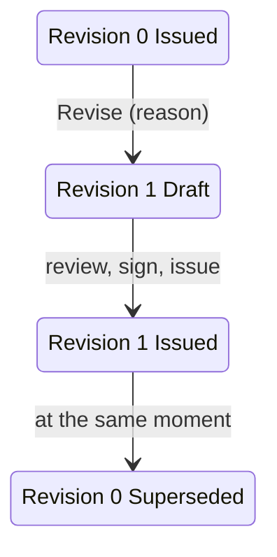

A test report is the signed result of testing one sample. The system makes one report per sample and keeps every revision of it. This page explains what the report holds and the rules around it. For the steps to review, sign and issue a report, see [Approvals](/help/features/approvals/).

:::note
MIS reports (the **Reports** menu entry) are a different thing: tables and exports about the lab's work. See [MIS reports](/help/features/mis-reports/).
:::

## Who can use it

| Role | Permission | What it allows |
| --- | --- | --- |
| Report Reviewer, Authorised Signatory, Dispatch, Accounts, Management | `reports.view` | Open report pages, preview any revision, download PDFs, see the delivery log and history. |
| Report Reviewer | `reports.review` | Correct drafts, choose photos, review, reject. |
| Authorised Signatory | `reports.approve` | Approve and sign, reject, correct drafts, choose photos. |
| Authorised Signatory | `reports.issue` | Issue, email again, send on WhatsApp. |
| Authorised Signatory | `reports.revise` | Start a new revision of an issued report. |

Customer details on report pages and in report lists need `customers.view` as well. Anyone, signed in or not, can use the public verification page with the code printed on the report.

## Where to find it

- **Approvals**, then the **Review**, **Sign**, **Issue** or **Issued** tab, then select a report.
- Search for a report number, or scan it, with the global search (see [Search and scanning](/help/features/search-scanning/)).

Report pages work in full on a phone.

## How a report is created

When the last open test on a sample is approved, the system creates the report with the next report number and revision 0, as a Draft. Everyone with `reports.review` is told "Report to review". If a test on the sample is later re-tested and approved again, the draft is refreshed with the new results, keeping the corrected description, reference, remarks and chosen photos.

A sample has only one report. Changes after issue are new revisions of the same report number.

## What the report contains

The PDF uses the lab's letterhead, with its logo as a faint watermark.

**Page 1**

- The format box: **Format no.**, **Issue no. and date**, **Revision no. and date**.
- The title **Test Report**. A draft says "DRAFT, NOT FOR ISSUE".
- For revision 1 or later: "Revision n. This report replaces … Reason: …".
- **Report issued to** (customer name and address), **Report no.** (with the ULR under it when there is one), **Issue date**, **Booking / receipt date**, **Test start date**, **Test completion date**, **Customer no.**, **Sample no.**, **Sample description**, **Customer reference**, **Kind attention**, **Email**, **Contact no.**, **Sample condition**, **Sample quantity and size**, and **Specification** when one was chosen.
- The sampling statement, unless the sample was drawn by the lab.
- **Deviations noted at receipt**, if any were recorded at booking.
- The verification QR code and link (see below). A draft says "A QR code for online verification is added when the report is approved." instead.

**Results**

- In NABL mode, **Tests within the scope of accreditation** (with the certificate number) and **Tests outside the scope of accreditation**. Otherwise one results table.
- Columns: **S.No**, **Test Parameter**, **Observed Result**, **Test Method** and **Limits**. When the sample is tested against two grades, there is a limits column for each.
- Only parameters marked **Show on report** in Masters are printed. Working values such as dimensions, loads and individual readings stay on the test record.
- **Remarks**: each test's observations and remarks.
- **Report remarks**, if any were added on the draft.
- **Sample photographs**, then **Figures**: the result images and graphs from the tests, numbered "Figure 1", "Figure 2" and so on, each with its caption, sample, test, instrument and date.
- **Annexures**, when tests have instrument reports on the report: a list of each annexure's letter, test, title, instrument and page count.
- **Reviewed by**, and the signatory's name, signature image (when the user has one) and "Authorised Signatory".
- "Electronically approved by … on …" with the report hash (SHA-256).

**Last pages**

- **General Terms & Conditions**, when the lab has set report terms.
- "End of Report", or "Annexure A follows" when there are annexures.
- The annexure pages: each page of the instrument's PDF, in order, under a header with the annexure letter, test, title and report number. "End of Report" is on the last annexure page.

<!-- screenshot: reports-pdf-page-one -->

## Graphs and instrument reports

Graphs and instrument PDFs added on a test (see [Attach graphs, instrument reports and raw data](/help/features/testing/#attach-graphs-instrument-reports-and-raw-data)) print only when **Print on report** is ticked for them.

- Images print as numbered figures in the report body.
- PDFs print as **annexures** A, B, C after the body. The annexures are part of the report: every page carries the report number and the report's own "Page x of y", where y counts the annexure pages too, so a missing page is noticed.
- The files are fingerprinted (SHA-256) when the report is approved. If a file were changed afterwards, the report would not be produced from it; contact your administrator.
- Raw data files and worksheets never print.

## Sample photographs

Photos of the sample can print in their own **Sample photographs** section after the results, numbered "Photo 1", "Photo 2" and so on, with their captions.

- Photos come from the sample (taken at booking) or are added on the draft report's **Photos** tab.
- Only photos of this sample are accepted, so one customer's photo cannot land on another's report.
- At most 12 photos. Print sizes run from 30 to 180 mm wide and up to 240 mm tall; the page offers Small, Medium, Large and Full width.
- The choice is made on the draft and frozen with it when the report is signed. New revisions start with the same choice.

See [Approvals](/help/features/approvals/#choose-sample-photos-for-the-report) for the steps.

## ULR numbers and NABL

When the lab turns on NABL mode in its lab profile (Admin, Lab profile, **Accreditation**), it must also enter the NABL certificate number and a ULR format. Then:

- a report gets a ULR number when it is signed, if at least one parameter on it is accredited;
- results are split into tests within and outside the scope of accreditation.

A ULR is given once. A new revision keeps the ULR of the report it replaces. Reports with no accredited parameters, and all reports while NABL mode is off, have no ULR. The ULR shows in the **ULR** column of report lists.

## Signature and fingerprints

Signing freezes the report's content, the lab profile as it was at that moment, the report format settings and the report terms. The system stores:

- the signatory's name, designation and signature image;
- a SHA-256 hash of the frozen content, which prints on the report;
- the SHA-256 of the final PDF, shown on the **Revisions and tests** tab as **PDF SHA-256** (a file cannot print its own fingerprint).

Approved and issued reports are never edited in place.

## Verification QR code and the public page

Each signed revision gets a random verification code. Page 1 prints a QR code and a link under **Verify this report**: "Scan the QR code with any phone camera, or open this link to check that the report is genuine and current".

The link opens **Test report verification**, a public page with no sign-in. It answers:

| Answer | When |
| --- | --- |
| **Genuine report** | The code belongs to a signed revision that has not been replaced. It names the laboratory, the approver and the approval date. |
| **This report has been replaced** | The revision was genuine, but a newer revision has been issued. It says which revision replaced it and when. |
| **No report matches this code** | The code is unknown, or the report is not signed. The document may not be genuine. |
| **The check could not be completed** | The page could not reach the server. **Try again** repeats the check. |

The page then lists **Laboratory**, **Report no.** (and ULR), **Issue date**, **Issued to** (the customer's name), **Sample no.**, **Sample description** and **Approved by**, and **Results on the report** for comparison with a printed copy.

Under **Check a PDF copy**, a person can select **Choose PDF file** to compare a PDF they received with the issued file. The file is checked on their device and is not uploaded. The page answers **The file matches** or **The file does not match**. **Report hash** shows the content hash printed under the approval.

The public page never shows addresses, contacts, customer numbers, prices, or the lab's tax and bank details. A report number alone cannot be used to look a report up.

:::note
Reports signed before verification codes were introduced have no QR code, because their stored PDFs are never re-rendered.
:::

<!-- screenshot: reports-verify-page -->

## Withheld reports

A customer can be set to **Withhold report release until payment is received** (on the customer's details, see [Customers](/help/features/customers/)). For that customer, an approved report cannot be issued until:

- at least one issued invoice covers the job, and
- every issued invoice for the job is paid.

Draft and cancelled invoices do not count. While release is withheld, the report page shows "Release is withheld for this customer until payment is received, so this report cannot be issued yet." and **Issue** is greyed out. See [Invoices and payments](/help/features/invoices-payments/).

## Revisions and corrections

**Goal:** correct a report that has already been issued.

**Who can do it:** Authorised Signatory (`reports.revise`).

**Before you start:** the report's latest revision is Issued.

**Steps:**

1. Open the report and select **Revise**.
2. Type the reason for the revision.
3. Select **Start revision**.
4. Correct the draft, review it, sign it and issue it as usual (see [Approvals](/help/features/approvals/)).

**Result:** a new revision (1, 2, …) starts as a Draft, built from the current test results with the previous description, reference, remarks and photos. When it is issued, the earlier revision becomes Superseded, and its verification code then answers "This report has been replaced". The new revision prints "Revision n. This report replaces … Reason: …".

The issued revision stays valid until the new one is issued. Every revision, including superseded ones, can still be downloaded from the **Revisions and tests** tab.

:::caution
Results on an approved test can only be reopened by rejecting a report that is In Review or Pending Approval with **Send tests back for re-testing**. To change a result after issue, start a revision, then reject that revision at review with re-testing.
:::
<!-- TODO(verify): confirm the intended way to change a result after issue is Revise, then reject the new revision at review with "Send tests back for re-testing" (the code allows it; no product text describes it). -->

## Download a report

**Goal:** get the PDF of a revision.

**Who can do it:** anyone with `reports.view`.

**Steps:**

1. Open the report and the **Revisions and tests** tab.
2. Select **Download revision n** on the revision you want.

**Result:** the PDF opens in a new tab. A revision that is not yet signed shows "No PDF yet"; use the **Preview** tab to see it.

## Email a report again

**Goal:** send the issued report to someone, again or for the first time.

**Who can do it:** Authorised Signatory (`reports.issue`).

**Before you start:** the report is Issued.

**Steps:**

1. Open the report and select **Email again**.
2. Enter **Email to** and, if needed, **Cc**.
3. Select **Send**.

**Result:** "Email queued" appears and the **Delivery** tab opens. The email carries the issued PDF as an attachment and uses the lab's test report email template (see [Email templates](/help/admin/email-templates/)). Its status shows in the **Email delivery log**. See [Email](/help/features/email/).

To send on WhatsApp, select **WhatsApp**. See [WhatsApp](/help/features/whatsapp/).

## Settings that affect reports

| Setting | Effect |
| --- | --- |
| [`report.formatNo`](/help/admin/settings/#report.formatNo) | **Format no.** on page 1. |
| [`report.issueNo`](/help/admin/settings/#report.issueNo) and [`report.issueDate`](/help/admin/settings/#report.issueDate) | **Issue no. and date** on page 1. |
| [`report.revisionNo`](/help/admin/settings/#report.revisionNo) and [`report.revisionDate`](/help/admin/settings/#report.revisionDate) | **Revision no. and date** of the report format (not the report's own revision). |
| [`report.samplingStatement`](/help/admin/settings/#report.samplingStatement) | The statement printed when the sample was not drawn by the lab. |
| [`numbering.formats`](/help/admin/settings/#numbering.formats) | The report number format (`REPORT`). The ULR format is part of the lab profile. |
| [`retention.reportYears`](/help/admin/settings/#retention.reportYears) | How long the lab keeps reports. |
| [`controls.allowSameReviewerSignatory`](/help/admin/settings/#controls.allowSameReviewerSignatory) | Whether the reviewer may also sign. |

The format settings are frozen onto each report when it is signed, so changing them later does not alter signed reports.

## Tips

- Use the **Revision** list on the **Preview** tab to look at an older revision.
- Tell customers to scan the QR code to check a copy.
- Choose photos before the report is signed; afterwards they cannot change without a revision.

## Limitations

- One report per sample; a job with several samples has several reports.
- The PDF of a signed report is never re-rendered with new branding or wording.
- A printed copy cannot be checked by file; compare its results with the verification page instead.

## Related

- [Approvals](/help/features/approvals/)
- [My Tests and result entry](/help/features/testing/)
- [Documents](/help/features/documents/)
- [Dispatch](/help/features/dispatch/)
- [Email](/help/features/email/)
