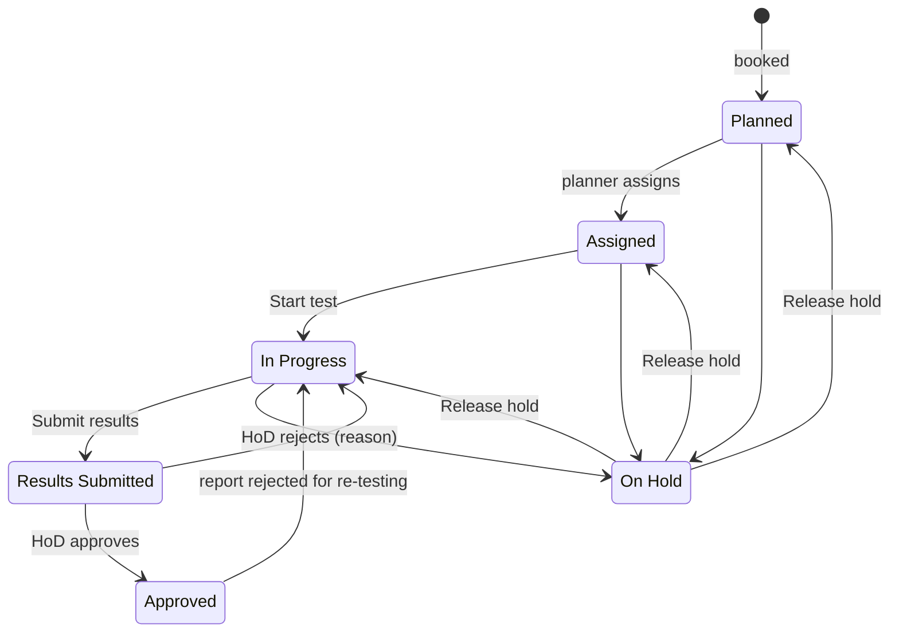

**My Tests** is the analyst's worklist. It lists the tests assigned to you, and opens each one on a test page where you record the instrument, complete the stages, enter results, add images and worksheets, and submit the results for approval.

## Who can use it

| Role | Permission | What it allows |
| --- | --- | --- |
| Technician / Analyst | `tests.work` | See **My Tests**, start your own assigned tests, enter results, submit them, and put your own tests on hold. |
| Lab Manager / Planner, Head of Department, Report Reviewer, Authorised Signatory, Quality Manager, Management | `tests.viewAll` | Open any test page read-only (for example from **Approvals** or a report). They do not see the **My Tests** menu entry unless they also hold `tests.work`. |
| Lab Manager / Planner, Head of Department | `tests.hold` | Put any test on hold and release it. |

Only the person a test is assigned to can start it, complete its stages, enter results or submit it. Anyone else who opens the test sees it read-only, with the note "You are viewing this test read-only. It is assigned to …".

:::note
The default Admin role does not include `tests.work`, so an administrator does not get a worklist unless a role with `tests.work` is added to their account.
:::

## Where to find it

Select **My Tests** in the left menu. On a phone it is in the bottom bar. A test page opens when you select a row, when you follow a notification such as "… was sent back", or when you scan a sample barcode (see [Search and scanning](/help/features/search-scanning/)).

On a phone **My Tests** and the test page work in full, the same as on a computer. Lists show as cards: the first four columns are on the card and the rest are under **More details**.

<!-- screenshot: testing-my-tests -->

## The My Tests list

The list is sorted with urgent tests first, then by due date ("Most urgent first, then soonest due"). It has two tabs:

| Tab | What it shows |
| --- | --- |
| **To do** | Your tests with status Assigned, In Progress or On Hold. |
| **Submitted and approved** | Your tests with status Results Submitted or Approved. |

Tests on cancelled jobs are not listed.

| Column | What it means |
| --- | --- |
| **Test** | Test code and name. Spectro or Wet analysis is shown under it when the test has an analysis mode. |
| **Sample** | Sample number. |
| **Job** | Job number. |
| **Customer** | Shown only when the lab lets technicians see customer names (see [Settings](#settings-that-affect-testing)). |
| **Status** | The test status. |
| **Current stage** | The next stage still to complete. |
| **Due** | Due date. An **Overdue** badge appears when the date has passed and the test is not approved. |
| **Urgent** | An **Urgent** badge for urgent jobs. |
| **Needs attention** | "Sent back:" with the approver's reason, or "On hold:" with the hold reason. |

Use **Search test, sample or job** to filter by test name, sample number or job number. Saved filters are available next to the search box.

When nothing is waiting, the list shows "Nothing is waiting for you".

## Test statuses

| Status | Meaning | What moves it on |
| --- | --- | --- |
| Planned | Booked, not yet given to an analyst. | The planner assigns it ([Planning](/help/features/planning/)). |
| Assigned | Given to an analyst. | The assignee selects **Start test**. |
| In Progress | Results can be entered. | The assignee selects **Submit results**. |
| Results Submitted | Waiting for approval. Results are locked. | A Head of Department approves or rejects it ([Approvals](/help/features/approvals/)). |
| Approved | Locked. | Only a report rejection that sends the test back for re-testing reopens it. |
| On Hold | Work is stopped, with a reason. | **Release hold** returns it to the status it had before. |
| Cancelled | No more work. | Final. See [Jobs and samples](/help/features/jobs-samples/). |

## Start a test

**Goal:** begin work on a test so you can record results.

**Who can do it:** the analyst the test is assigned to, with `tests.work` (Technician / Analyst).

**Before you start:** the test must be Assigned to you, and its job must not be on hold or cancelled.

**Steps:**

1. Open **My Tests** and select the test.
2. Select **Start test** at the top of the page.

**Result:** the status changes to In Progress, you are recorded as **Test conducted by**, and the result fields become editable. The job moves to In Testing if it was Planned.

**Related:** [Planning](/help/features/planning/)

## The test page

The page header shows the test code and name, the status, and **Urgent** or **Overdue** badges. Under it are the sample number, job number, sample description, the customer name (only when technicians may see it), the method and the due date.

Banners above the tabs tell you what you need to know:

- **Sent back for correction**, with the approver's or report reviewer's reason.
- **On hold:** with the reason.
- A note when you cannot edit, for example "Results were submitted on … and are waiting for approval. They are locked." or "Start the test to enter results."

The page has three tabs: **Results**, **Images and worksheets** and **History**.

<!-- screenshot: testing-test-page -->

### Results tab

| Card | What it holds |
| --- | --- |
| **Stages** | The test's stages in order, each with who completed it and when. The next one has a **Complete** button. |
| **Instrument and analyst** | **Instrument** (a list of active instruments; overdue ones say "(calibration overdue)") and **Test conducted by**. A warning appears when the chosen instrument was due for calibration. |
| **Instructions** | **Analysis mode**, **Office instructions** and **Technical data** from booking and planning, when there are any. |
| **Results** | One row per parameter: **Parameter**, **Result**, **Unit**, **Limits**, **Pass or fail**. **Overall:** shows Pass, Fail or No limits. |
| **Remarks, observations and notes** | Three free-text fields. |
| **Unit converter** | Shown when the lab has unit conversions set up in Masters. |

## Complete the stages

**Goal:** record each step of the method as you finish it.

**Who can do it:** the assignee, with `tests.work`.

**Before you start:** the test is In Progress.

**Steps:**

1. On the **Results** tab, find the **Stages** card.
2. Select **Complete** next to the stage marked **Next**.

**Result:** the stage shows "Done by" your name and the time, and the next stage becomes **Next**.

Stages complete strictly in order. The server refuses a later stage with "Complete the earlier stages first". A test with no stages shows "This test has no stages."

## Enter results

**Goal:** record a value for every parameter.

**Who can do it:** the assignee, with `tests.work`.

**Before you start:** the test is In Progress and its job is not on hold.

**Steps:**

1. On the **Results** tab, choose the **Instrument** you used, if any.
2. Type a value in each **Result** field. Press Enter to move to the next reading.
3. For a parameter with a list of allowed results, pick one from **Choose…**.
4. Add **Remarks**, **Observations** or **Notes** if needed. Use **Add from a template…** to insert a standard remark; templates that match the outcome so far are listed under **Suggested for this result**.

**Result:** each value is saved as you type, and the server fills in calculated results, limits and **Pass or fail**.

### Kinds of result

| Kind | How you enter it |
| --- | --- |
| Numeric | A number. It is rounded to the parameter's decimal places. A field that is not a number shows "Enter a number" and is not sent. |
| Below or above the measurable range | Type `<` or `>` before the number, for example `<0.005`. Pass or fail is shown only when it is certain from the qualifier. |
| Text | Any text. |
| Result set | One of the allowed values in the list. Each value may count as pass or fail. |
| Calculated | Not typed. The server works it out from other parameters and shows the result, the working and the inputs used. |

### Calculations

A calculated parameter uses the values of other parameters exactly as reported, at their stated decimals, so anyone can repeat the working from the printed figures. While inputs are missing it shows "Waiting for …" with the missing parameter codes. A calculated result cannot use a value entered with `<` or `>`; it then shows "Can't calculate from a result entered with < or > (…)". All arithmetic happens on the server.

When results are submitted, each calculated result records which formula version produced it.

### Pass or fail

Limits come from the specification chosen for the sample (see [Planning](/help/features/planning/)). When a sample is tested against two grades, each grade's limit and verdict are shown separately. A row that fails is highlighted, and pass and fail are always written in words as well as colour.

## Autosave

Results, the instrument and the remarks fields are saved automatically about a second after you stop typing, and when you leave a field. The bar at the bottom of the page shows **Saving…**, **Saved** or **Failed**.

- If a save fails for a network or server reason, it is tried again. **Retry save** sends it at once.
- If the server refuses a value, the message appears on that field, what you typed stays there, and the rest of the save goes through.
- If the test was changed elsewhere (for example on another device), the message "This test was changed elsewhere. The latest version has been loaded; please check your last entries." appears.
- If you try to leave the page with entries that could not be saved, **Leave without saving?** asks you to confirm.

:::caution
Every changed result is recorded in the test's history with its old and new value, and "entered by" moves to whoever changed that value. Do not use the result fields for scratch work.
:::

## Attach images and worksheets

**Goal:** keep photos of the test and its worksheets with the result.

**Who can do it:** the assignee, with `tests.work`, while the test is In Progress.

**Steps:**

1. Open the **Images and worksheets** tab.
2. Under **Result images**, set **Print width (mm)** and **Print height (mm)** if you want a size other than the default 80 × 60 mm.
3. Select **Add file** and choose a PNG or JPEG image. Or select **Use phone** to send photos from a phone (see [Photos from a phone](/help/features/phone-upload/)).
4. Under **Worksheets**, select **Add file** to attach a PDF or image.

**Result:** the file is listed by name, with its print size for images. Select the name to open it.

Result images print on the test report under the results, with the test name as caption. Photos are shrunk in the browser before upload (about 2000 pixels on the long side, under 1 MB). To remove a file, select the bin icon; the removal stays in the audit history.

## Submit results

**Goal:** send the finished results for approval.

**Who can do it:** the assignee, with `tests.work`.

**Before you start:** every stage is complete, every parameter has a value, and no field is marked with an error.

**Steps:**

1. Select **Submit results** in the bar at the bottom of the page.
2. In **Submit these results?**, select **Submit results**.

**Result:** the toast "Results submitted for approval" appears, the status changes to Results Submitted, and the results are locked. Everyone with `tests.approve` gets a "Results to approve" notification.

The server refuses to submit when:

- a stage is not complete ("Complete every stage before submitting");
- a parameter has no value ("Enter a result for: …");
- a value is invalid;
- the chosen instrument is past its calibration due date and the lab blocks overdue instruments.

## When results are sent back

If a Head of Department rejects your results, or a report is rejected for re-testing, the test returns to In Progress. You get a "… was sent back" notification, the **Needs attention** column shows "Sent back:" with the reason, and the test page shows **Sent back for correction**. Correct the results and submit again.

## Put a test on hold or release it

**Goal:** stop work on a test, with a reason, and start again later.

**Who can do it:** the assignee with `tests.work` (own tests only), or anyone with `tests.hold` (Lab Manager / Planner, Head of Department) for any test.

**Steps:**

1. On the test page, select **Put on hold**.
2. Type the reason and select **Put on hold**.
3. To continue later, select **Release hold**, then **Release hold** again to confirm.

**Result:** on hold, the reason shows on the page and in **My Tests**. On release, the test returns to the status it had before. A test on a job that is on hold or cancelled cannot be released.

## Print test data

Select **Print test data** to open a Test Data Sheet PDF with the stages, each result with its unit and working, and the remarks, observations and notes. Anyone who can open the test can print it. See [Documents](/help/features/documents/).

## Report a problem

**Goal:** tell the quality team about something wrong with the equipment, a reagent, the sample or the method.

**Who can do it:** anyone with `tests.work`, `jobs.view` or `quality.view`, when the Quality module is on.

**Steps:**

1. On the test page, select **Report a problem**.
2. Fill in the form (below) and select **Report**.

**Result:** the toast "Reported as … The quality team will take it from here." appears, with the non-conformance number in place of …. You can follow it under **Problems I reported** on [My account](/help/features/account/).

| Field | What it means | Required |
| --- | --- | --- |
| **In a few words** | A short title, up to 200 characters. | Yes |
| **What happened** | What you saw, when, and anything you did about it. | Yes |
| **How serious** | **Minor: worth fixing**, **Major: results may be affected** or **Critical: stop and check now**. | Yes (defaults to Minor) |
| **Where it came from** | Routine work, Complaint, Customer feedback or Other. | Yes (defaults to Routine work) |
| **Concerns** | Filled in with the sample and test code. Up to 100 characters. | No |

See [Quality](/help/features/quality/) for how the quality team works it.

## History tab

The **History** tab lists every change to the test: status changes, stage completions and result changes, each with the time, who made it, the reason where one was given, and the before and after values under **Changes**.

## Settings that affect testing

| Setting | Effect |
| --- | --- |
| [`controls.impartiality`](/help/admin/settings/#controls.impartiality) | On by default. Customer names are hidden on My Tests and the test page. |
| [`controls.blockOverdueInstruments`](/help/admin/settings/#controls.blockOverdueInstruments) | When on, an instrument past its calibration due date cannot be chosen or submitted with; the field shows "Instruments overdue for calibration cannot be used." |
| [`controls.allowSelfApproval`](/help/admin/settings/#controls.allowSelfApproval) | Off by default, so someone else must approve the results you entered. |
| [`notifications.tatWarningDays`](/help/admin/settings/#notifications.tatWarningDays) | How many days before the due date the assignee gets a "Due soon" notification. Once the due date has passed, the assignee and everyone with `planning.edit` get "TAT crossed". |

## Tips

- Press Enter to move down a column of readings without the mouse.
- Wait for **Saved** before closing the tab; the browser also warns you when something is unsaved.
- Use **Use phone** to photograph a specimen at the bench without moving files around.

## Limitations

- Only the assignee can enter results. A planner must reassign a test before someone else can work on it.
- Results cannot be changed after submission unless they are sent back.
- A calculated result cannot be overwritten by hand.
- Result images accept PNG and JPEG only.

## Related

- [Planning](/help/features/planning/)
- [Approvals](/help/features/approvals/)
- [Test reports](/help/features/reports/)
- [Photos from a phone](/help/features/phone-upload/)
- [Quality](/help/features/quality/)
- [Using the LIMS on a phone](/help/guides/on-a-phone/)
