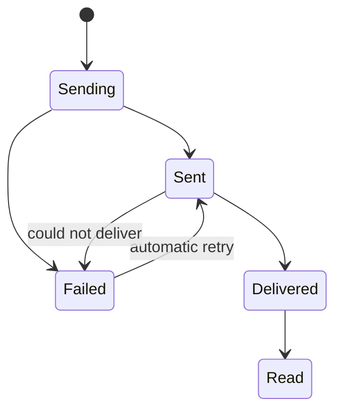

When your lab has connected its WhatsApp Business number, you can send customers four kinds of message from the record itself: an issued test report, an issued invoice, the samples-received acknowledgement, and a payment reminder. The PDF goes with the message where there is one. You can see whether each message was sent, delivered and read.

This page is for the people who send messages. Connecting the number and choosing the message templates is an administrator's job: see [WhatsApp setup](/help/integrations/whatsapp/).

:::note
WhatsApp is a module. It stays off until the server administrator has added the WhatsApp settings, and an administrator can turn it off in Admin → Modules. When it is off, the WhatsApp buttons are hidden. Invoices and reminders also need the Billing module.
:::

## Who can send what

The people who may email each kind of document may also send it on WhatsApp.

| Message | Where | Button | Permission | Default roles |
| --- | --- | --- | --- | --- |
| Test report (PDF) | An issued report (**Approvals**) | **WhatsApp** | `reports.issue` | Authorised Signatory, Admin |
| Invoice (PDF) | An issued, partly paid or paid invoice | **WhatsApp** | `invoices.edit` | Accounts, Admin |
| Payment reminder | An issued or partly paid invoice | **Remind on WhatsApp**, or **Send it on WhatsApp instead** in the reminder dialog | `reminders.send` | Accounts, Admin |
| Samples-received letter (PDF) | The job page, **Acknowledgement emails** card | **WhatsApp**, or **Use WhatsApp instead** in the email dialog | `jobs.create` or `jobs.edit` | Sample Reception, Admin |

Anyone who can see the record (`reports.view`, `invoices.view` or `jobs.view`) can see what was sent before.

## Send a message on WhatsApp

**Goal:** send a document or reminder to the customer's WhatsApp.

**Who can do it:** see the table above.

**Before you start:** the customer must have agreed to receive WhatsApp messages from your lab. A report must be **Issued**; an invoice must be issued (not a draft or cancelled); a reminder needs an unpaid balance.

**Steps**

1. Open the report, invoice or job.
2. Select **WhatsApp** (or **Remind on WhatsApp** on an invoice).
3. If the customer has more than one contact with a phone number, choose one under **Customer contact**, or **Someone else**.
4. Check the **WhatsApp number** and the **Greeting name**.
5. Tick **The customer agreed to receive messages from us on WhatsApp**.
6. Select **Send on WhatsApp**.

**Result:** the toast says "Queued for WhatsApp. The PDF is attached once it is ready." (or "Reminder queued for WhatsApp"). The message appears under **Sent before** the next time you open the dialog, with its status.

<!-- screenshot: whatsapp-send-dialog -->

| Field | What it means | Required |
| --- | --- | --- |
| **Customer contact** | Shown when the customer has more than one contact with a phone number. Picks the number and greeting name. The first contact (the primary one) is filled in for you. | No |
| **WhatsApp number** | The mobile number. Indian numbers can be written without +91; other countries need their country code. | Yes |
| **Greeting name** | The name the message greets. Leave empty for "Sir/Madam" (for reports and acknowledgements, the job's kind-attention name is used when empty). Up to 80 characters. | No |
| **The customer agreed to receive messages from us on WhatsApp** | Your confirmation of consent. **Send on WhatsApp** stays disabled until it is ticked. | Yes |

If the number is not a mobile number, the dialog says "Enter a WhatsApp mobile number, with the country code for numbers outside India".

:::caution
Tick the consent box only when the customer has really agreed. Your name is stored on the message as the person who confirmed consent, and the send is written to the audit log.
:::

## What the customer receives

WhatsApp only lets a business start a conversation with a message template it has approved. Your lab's administrator chose the templates and the values they carry (contact, customer, lab name and phone, document numbers, dates, amounts). The customer gets that approved wording with:

- **Report:** the PDF of the issued revision, named like "Report LAB-TR-26-27-000045.pdf" (with "rev 1" for a revision).
- **Invoice:** the invoice PDF, rendered first if it is not stored yet.
- **Samples-received letter:** the acknowledgement PDF, with the photos you chose if you opened it from the email dialog.
- **Payment reminder:** text only, with the balance, due date and days overdue.

A reminder sent on WhatsApp is also logged on the invoice's **Reminders** tab, as a manual reminder.

## Message statuses

Each message shows a status like WhatsApp's own ticks, with the time it got there.

| Status | Meaning |
| --- | --- |
| **Sending** | Queued in the system, or waiting for its PDF |
| **Sent** | WhatsApp accepted it |
| **Delivered** | It reached the customer's phone |
| **Read** | The customer opened it |
| **Failed** | WhatsApp refused it or could not deliver it. The reason shows under the message. |

- A message that fails to send is retried automatically, up to five attempts in all, waiting longer each time.
- A status only moves forwards, so a late receipt never turns **Read** back into **Delivered**.
- **Delivered** and **Read** need the lab's server to receive WhatsApp's delivery receipts. Without that part of the setup, messages still go but stay at **Sent**.
- The open dialog refreshes by itself while a message is **Sending**, and now and then while it is **Sent** or **Delivered**.

## Privacy

- Contact phone numbers are suggested only to people with `customers.view`. Others type the number.
- In **Sent before**, people without `customers.view` see past numbers masked, for example ••••3210.

## Tips

- Send the acknowledgement from the **Email the acknowledgement** dialog with **Use WhatsApp instead** to include the photos you picked there.
- From **Due Invoices**, open **Send reminder** and use **Send it on WhatsApp instead** for customers who do not answer email.
- If a message shows **Failed** with a template or language error, ask your administrator to check the template in Admin → WhatsApp.

## Limitations

- Messages are sent one at a time, by a person. Automatic payment reminders go by email only.
- Quotations and proforma invoices cannot be sent on WhatsApp.
- Customers' replies are not shown in the system; they arrive in the lab's WhatsApp Business app.
- No SMS, and no Hindi wording.

## Related

- [WhatsApp setup](/help/integrations/whatsapp/) for administrators.
- [Email](/help/features/email/): the same documents by email.
- [Test reports](/help/features/reports/)
- [Invoices and payments](/help/features/invoices-payments/)
- [Due invoices](/help/features/due-invoices/): reminders.
- [Jobs and samples](/help/features/jobs-samples/): the acknowledgement.
