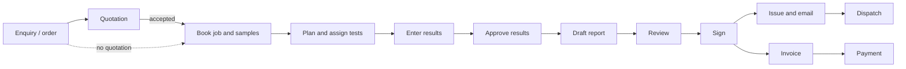

The LIMS runs a testing laboratory from the first enquiry to the last payment. It holds your customers, quotations, samples, tests, results, reports, dispatches and invoices in one place, and it keeps a history of every change. It is built for Indian testing laboratories: GST invoices, the Indian financial year in document numbers, NABL ULR numbers, and WhatsApp for customer messages.

Your laboratory sees its own name, logo and colours. This help uses generic examples such as *Contoso Forgings Ltd*.

## Who it is for

- **The front office**: sales staff who answer enquiries and send quotations, and the reception desk that books samples.
- **The laboratory**: the lab manager who plans and assigns tests, the technicians who enter results, and the heads of department who approve them.
- **Reporting**: the reviewers and authorised signatories who check, sign and issue test reports.
- **The back office**: dispatch, accounts and management.
- **Quality and documents**: the quality manager and the document controller.
- **The administrator**: who sets up users, roles, masters and settings.

Each person sees only the menus and buttons their role allows. The server checks the same permissions on every request, whatever screen or device is used.

## The modules

| Module | What it covers | Menu |
| --- | --- | --- |
| Customers | Customer records, contacts, billing and report addresses, GSTIN, credit days, history | **Customers** |
| Orders and quotations | Enquiries (orders), quotations and proforma invoices, versions, sending, acceptance | **Orders**, **Quotations** |
| Booking | Booking a job and its samples, from an accepted quotation or without one; deviations; acknowledgements; labels | **Samples** |
| Planning | Choosing the tests and specification for each sample, assigning technicians and instruments | **Planning** |
| Testing | Stages, results, images and worksheets for each test | **My Tests** |
| Approvals and reports | Approving results, reviewing draft reports, signing, issuing, revising | **Approvals** |
| Dispatch | Dispatch records and challans, returnable samples, retention and disposal | **Dispatch** |
| Billing | Tax invoices, payments, advances, credit notes, payment reminders | **Invoices**, **Due Invoices** |
| Dashboards and MIS | Your dashboard, analytics charts, and MIS reports with Excel and PDF export | **Dashboard**, **Analytics**, **Reports** |
| Quality | Equipment calibration and maintenance, staff authorisations and training, non-conformance and CAPA | **Quality** |
| Files | A library of SOPs, certificates and customer letters, plus every file the system produces | **Files** |
| WhatsApp and email | Sending reports, invoices, acknowledgements and reminders to customers | Buttons on each record |

Customers, booking, planning, testing, approvals, reports and masters are always on. Your administrator can turn off orders and quotations, dispatch, billing, the file library, photos from a phone, analytics and MIS reports, quality management and WhatsApp. Turning a module off deletes nothing. See [Modules](/help/admin/modules/).

## The roles

A new installation starts with these roles. Your administrator can change what each role may do, add roles, and give a person more than one role.

| Role | In short |
| --- | --- |
| Admin | Users, roles, masters, settings, audit log, all records |
| Sales / Business Development | Customers, orders, quotations |
| Sample Reception | Job booking, sample request form (SRF), acknowledgements, labels, deviations |
| Lab Manager / Planner | Test planning, assignment, job cards, workload |
| Technician / Analyst | Assigned tests only: stages, results, attachments |
| Head of Department | Approves test results |
| Report Reviewer | Reviews draft reports |
| Authorised Signatory | Final approval or rejection, electronic signature, issuing |
| Dispatch | Dispatch records and challans |
| Accounts | Rates, invoices, payments, due invoices |
| Management | Read-only dashboards and reports |
| Quality Manager | Equipment, staff competency, non-conformance and CAPA |
| Document Controller | File library: folders, uploads, controlled documents |

Find the guide for your role in [Find your role](/help/guides/).

## The main flow

Each step is described, with who does it, in [The sample lifecycle](/help/getting-started/sample-lifecycle/).

## Where to go next

- [Key concepts](/help/getting-started/concepts/): the words the system uses.
- [Quick start](/help/getting-started/quick-start/): your first ten minutes.
- [System requirements](/help/getting-started/system-requirements/): browsers, screens, printers and scanners.
- [The sample lifecycle](/help/getting-started/sample-lifecycle/): from enquiry to payment.
- [Role guides](/help/guides/): your day, written as tasks.
- [Features](/help/features/): every screen, field and button, one module at a time.
- [Administration](/help/admin/): users, roles, settings, branding and masters.
- [Integrations](/help/integrations/): email, WhatsApp and other connections.
- [Installation](/help/install/requirements/): for the person who runs the server.
- [Developers](/help/developers/): the API.
- [Security](/help/security/): how data and access are protected.
- [Troubleshooting](/help/troubleshooting/): when something does not work.
