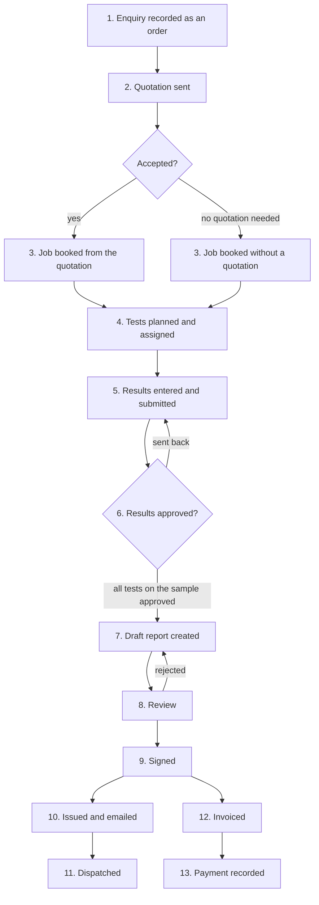

This page follows one piece of work from the customer's first enquiry to the final payment. Each stage names the role that usually does it, with links to that role's guide and to the feature page.

In the example, *Contoso Forgings Ltd* sends two steel samples for chemical analysis and a tensile test.

## 1. Enquiry

The customer asks for tests by email, phone, letter or in person. Sales records it as an **order** with **New order**, noting the **Source** and **Reference**. The order's stage moves from **New** to **Quoted**, **Won** or **Lost**.

Orders are optional; you can go straight to a quotation.

- **Who**: Sales / Business Development (`orders.edit`)
- **Read more**: [Sales guide](/help/guides/sales/), [Orders and quotations](/help/features/orders-quotations/)

## 2. Quotation

Sales creates a **New quotation** with a line for each sample and test. The server looks up the rates, applies discounts and works out GST. The quotation is sent by email with **Send**. If the customer accepts on the phone or at the counter, **Customer accepted** records it without emailing. A sent quotation is marked **Accept** or **Reject**, or revised into a new version.

- **Who**: Sales / Business Development (`quotations.edit`, `quotations.send`, `quotations.decide`)
- **Read more**: [Sales guide](/help/guides/sales/), [Orders and quotations](/help/features/orders-quotations/)

## 3. Booking

The samples arrive. Sample Reception opens **Samples**, then **Book samples**.

- **From an accepted quotation**: choose it under **Book from an accepted quotation** and select **Book job**. The job gets the quotation's samples and tests. This can be done once.
- **Without a quotation**: fill in the customer, the **Reason for no quotation**, each sample and its **Requested tests**, any deviations, and select **Book job**.

The job and each sample get their numbers. Reception prints the labels, adds photos if needed and emails the acknowledgement to the customer. The job's status is **Received**.

- **Who**: Sample Reception (`jobs.create`, `jobs.createWithoutQuotation`, `quotations.convert`)
- **Read more**: [Sample Reception guide](/help/guides/sample-reception/), [Booking](/help/features/booking/), [Jobs and samples](/help/features/jobs-samples/)

## 4. Planning and assignment

The lab manager opens **Planning**. For each job they plan the samples: choose the **Grade / specification** (and a **Second grade (dual grade)** if needed), confirm the tests, and select **Create plan**. Each test gets a due date from its TAT. Then they **Assign** the tests to technicians and instruments, seeing each person's and instrument's open work. Once every test on the job is planned, the job moves to **Planned**.

- **Who**: Lab Manager / Planner (`planning.edit`)
- **Read more**: [Lab Manager / Planner guide](/help/guides/lab-manager-planner/), [Planning](/help/features/planning/)

## 5. Testing

The technician finds the test in **My Tests**, selects **Start test**, completes each stage in order, picks the instrument, and types the results. Results save as they type and show **Pass** or **Fail** against the specification. When everything is in, they select **Submit results**. The job moves to **In Testing** when work on its tests starts.

- **Who**: Technician / Analyst (`tests.work`)
- **Read more**: [Technician / Analyst guide](/help/guides/technician-analyst/), [Testing](/help/features/testing/)

## 6. Approving results

The head of department opens **Approvals**, tab **Results**, checks each test's results, and selects **Approve** or **Reject**. A rejected test goes back to the technician with the reason. Nobody can approve results they entered themselves. Approved results are locked.

- **Who**: Head of Department (`tests.approve`)
- **Read more**: [Head of Department guide](/help/guides/head-of-department/), [Approvals](/help/features/approvals/)

## 7. Draft report

When every active test on a sample is approved, the system creates a draft report for that sample by itself. Once every sample on the job has all its tests approved, the job moves to **Reporting**.

- **Who**: the system
- **Read more**: [Reports](/help/features/reports/)

## 8. Review

The report reviewer opens the draft from **Approvals**, tab **Review**. They can **Correct draft** (description, customer reference, remarks), choose the sample photos to print, and **Submit for review**. After checking, they select **Pass review**, or **Reject** it for correction or re-testing.

- **Who**: Report Reviewer (`reports.review`)
- **Read more**: [Report Reviewer guide](/help/guides/report-reviewer/), [Approvals](/help/features/approvals/)

## 9. Signing

The authorised signatory opens the report from **Approvals**, tab **Sign**, and selects **Approve and sign**. They enter their password as an electronic signature. The content is frozen, a ULR number is given if NABL mode applies, and the final PDF with its verification QR code is prepared.

- **Who**: Authorised Signatory (`reports.approve`)
- **Read more**: [Authorised Signatory guide](/help/guides/authorised-signatory/), [Reports](/help/features/reports/)

## 10. Issuing

From **Approvals**, tab **Issue**, the signatory selects **Issue**, optionally enters an email address, and selects **Issue report**. The customer gets the PDF by email. It can also be sent on WhatsApp. If the customer's report release is withheld until payment, the report cannot be issued until then. When every sample on the job has an issued report, the job is **Completed**.

- **Who**: Authorised Signatory (`reports.issue`)
- **Read more**: [Authorised Signatory guide](/help/guides/authorised-signatory/), [Email](/help/features/email/), [WhatsApp](/help/features/whatsapp/)

## 11. Dispatch

Dispatch opens **Dispatch**, tab **Pending**, and selects **Record dispatch** for the job. They tick the issued reports and returnable samples going out, enter the mode and courier details, and select **Save dispatch**. A challan is produced. Samples that are kept are tracked under **Returnable samples** until they are returned or disposed of.

- **Who**: Dispatch (`dispatch.edit`)
- **Read more**: [Dispatch guide](/help/guides/dispatch/), [Dispatch](/help/features/dispatch/)

## 12. Invoicing

Accounts opens **Invoices**, tab **Ready to invoice**, selects the job (or several jobs for the same customer) and selects **Create draft invoice**. They check the draft and select **Issue**. The invoice gets its number and due date, and can be emailed.

- **Who**: Accounts (`invoices.edit`)
- **Read more**: [Accounts guide](/help/guides/accounts/), [Invoices and payments](/help/features/invoices-payments/)

## 13. Payment

When the money arrives, Accounts selects **Record payment**, enters the amount and allocates it to open invoices. Anything not allocated stays on account as an advance. Unpaid invoices appear in **Due Invoices** with their ageing, and reminders can be sent by email or WhatsApp.

- **Who**: Accounts (`payments.edit`, `reminders.send`)
- **Read more**: [Accounts guide](/help/guides/accounts/), [Due invoices](/help/features/due-invoices/)

## When things go off the normal path

- **Hold**: a job or test can be put on hold with a reason, and released later. Work stops while it is on hold.
- **Cancel**: a job, sample or test can be cancelled with a reason. The system first shows what the cancellation affects.
- **Send back**: results, or a report, can be sent back with a reason at any approval step.
- **Revise**: an issued report can be revised. The new revision goes through review and signing again; the old one stays valid until the new one is issued.
- **Problems**: anyone at the bench or front desk can use **Report a problem** on a job or test. It goes to the quality team as a non-conformance.

## Related

- [Key concepts](/help/getting-started/concepts/)
- [Find your role](/help/guides/)
