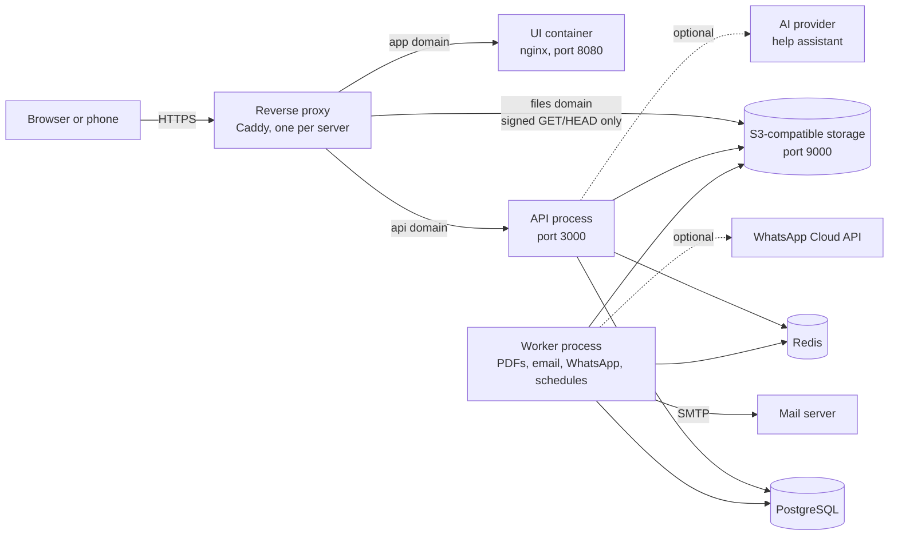

This page is for IT staff. It explains what runs on the server, how the parts talk to each other, and what each one stores. Each laboratory (company) gets its own complete set of containers. Nothing that holds lab data is shared between companies.

## The parts

| Part | What it does | Stores data |
| --- | --- | --- |
| Reverse proxy (Caddy) | Ends TLS, gets and renews certificates, sends each domain to the right container. One per server, shared by every company on it. | No lab data. Only certificates. |
| UI container (nginx) | Serves the web app (a single-page app) and its runtime settings file. | No |
| API process | Answers every request from the app under `/api/v1`. Holds all business rules, permissions, calculations and the audit log. | No (uses the database) |
| Worker process | Renders PDFs with Chromium, builds Excel exports, sends email and WhatsApp messages, runs scheduled jobs. Serves no HTTP. | No (uses the database) |
| PostgreSQL | All records: customers, jobs, results, reports, invoices, settings, the lab profile and the audit log. | Yes |
| Redis | Sign-in sessions, background job queues and short-lived caches. | Yes (sessions and queues) |
| S3-compatible storage | Files: report PDFs, invoices, photos, attachments, the lab's logo. | Yes |
| Mail server (SMTP) | Your own mail provider. The worker sends all email through it. | Outside the stack |
| WhatsApp Cloud API | Optional. Sends reports and invoices on WhatsApp. See [WhatsApp](/help/integrations/whatsapp/). | Outside the stack |
| AI provider | Optional. Answers questions in the help site's assistant. See [AI help assistant](/help/integrations/ai-assistant/). | Outside the stack |

The help assistant runs inside the API process: only the API calls the AI provider, and the key never leaves it.

The API and the worker are the **same image**, started with a different command: `node dist/main.js api` or `node dist/main.js worker`. The UI is a second image. One pair of images serves every company; company details are never built into an image.

## Domains

Each company uses three names, usually under one parent domain:

| Name | Example | Goes to |
| --- | --- | --- |
| App | `app.lims.example.com` | UI container |
| API | `api.lims.example.com` | API process |
| Files | `files.lims.example.com` | Storage, for short-lived signed download links only |

The proxy passes only signed `GET` and `HEAD` requests to the files domain. Every other storage request, including the storage admin API, gets `403`.

The help site is served at `/help/` on the app address, for example `https://app.lims.example.com/help/`.
The UI image builds the help site and its search index, and nginx serves them from `/help/` with their own security policy (the app's, plus Cloudflare Turnstile for the assistant's bot check).

## One company per stack

Each company is one Docker Compose project named `lims-<slug>`, with its own:

- PostgreSQL, Redis and storage containers
- named volumes (`pgdata`, `redisdata`, `miniodata`)
- generated passwords and keys
- API, worker and UI containers

Only the reverse proxy and its `lims-proxy` Docker network are shared. The proxy addresses each company's containers by their unique names (`lims-<slug>-api-1`), and the app reaches its storage through an alias that exists only on that company's internal network. So one company can never reach another's data.

:::note
Upgrades, backups, restores and rollbacks all work on one company at a time. You can upgrade one lab and leave another on the old version.
:::

## Where things run

| Container | Networks | Ports published |
| --- | --- | --- |
| `caddy` (proxy) | `lims-proxy` | 80, 443 (TCP and UDP) |
| `ui` | `lims-proxy` | None |
| `api` | internal, `lims-proxy` | None |
| `worker` | internal | None |
| `postgres`, `redis` | internal | None |
| storage (`minio` service) | internal, `lims-proxy` | None |
| `migrate` (runs once per deploy, then exits) | internal | None |

Only the proxy publishes ports. PostgreSQL and Redis are never reachable from outside the server.

## Database roles

The app connects to PostgreSQL as `lims_app`, which can read and write rows but owns no tables. Migrations run as `lims_owner`, and only the one-off `migrate` container holds that password. This means the running app cannot change the schema or switch off the audit log's append-only protection.

## Where the lab's details live

Server settings (domains, mail server, storage image, memory limits, backups) live in files on the server. Everything about the lab itself, such as its name, GSTIN, bank details, NABL details, logo and colours, is entered by the lab's administrator in the app and stored in the database. Changing those needs no restart and no redeploy. See [Setup wizard](/help/admin/setup-wizard/).

## Next steps

- [Server requirements](/help/install/requirements/)
- [Install with Docker](/help/install/docker/)
- [Environment variables](/help/install/environment/)
