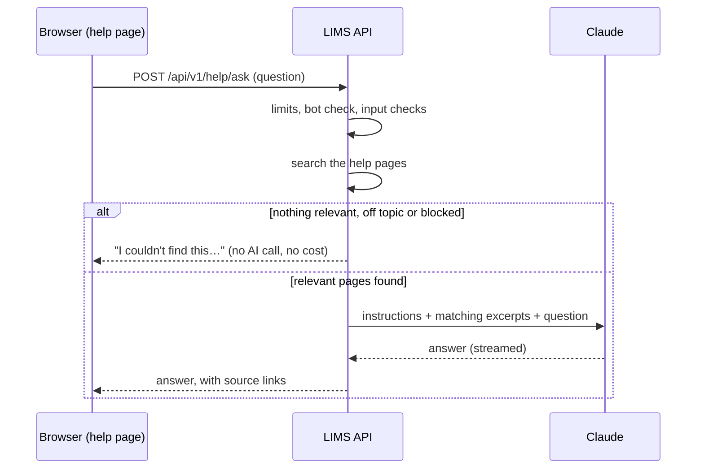

The help assistant is the **Ask AI** button on every help page. It answers questions from this documentation only, with links to the pages and sections it used. The browser talks to your LIMS server; only the server talks to the AI provider, so the key never reaches a browser. What administrators see is on [Help assistant](/help/admin/help-assistant/).



## Turn it on

**Goal:** make **Ask AI** answer questions.
**Who can do it:** whoever runs the server.
**Before you start:** an Anthropic account, and the help site deployed at `/help/` (it is part of the UI container).

1. In the [Anthropic Console](https://console.anthropic.com/), create a **separate workspace** for the help assistant and an API key in it. Do not reuse a key that other systems use.
2. On that workspace, set a **spend limit** (in the Console's workspace or billing limits). This is the hard ceiling: even if every other protection failed, the provider stops at this amount.
   <!-- TODO(verify): the exact menu names in the Anthropic Console for workspace spend limits. -->
3. In the server's environment (`deployment.env` with LIMS-Deploy), set:

   ```bash
   ENABLE_AI_ASSISTANT=true
   AI_API_KEY=<your-anthropic-key>
   ```

4. Redeploy. Open any help page and choose **Ask AI**.

**Result:** the panel shows suggested questions and answers in a few seconds. If it says the assistant is not available, see [Troubleshooting](#troubleshooting).

:::caution
The key is read from the environment on the server only. It is never sent to the browser, written to logs, or stored in the database. Never put it in the UI's settings, the docs, or git.
:::

## Settings

All are environment variables on the API server. Only `ENABLE_AI_ASSISTANT` and `AI_API_KEY` are needed to start; the rest have safe defaults.

| Variable | Default | What it does |
| --- | --- | --- |
| `ENABLE_AI_ASSISTANT` | `false` | `true` turns the assistant on. It stays off, and the help site offers search only, unless the provider can be used. |
| `AI_PROVIDER` | `anthropic` | `anthropic` (Claude); `openai-compatible`: any service with that interface, your own model server included; or `mock`: offline answers made from the matching excerpt, for development and tests. Any other value stops the server. |
| `AI_BASE_URL` | none | The address of an `openai-compatible` service, for example `https://llm.example.com/v1`. |
| `AI_PRICE_INPUT`, `AI_PRICE_OUTPUT` | Claude's prices | US dollars per million tokens, needed for any model the server does not know. Without a price the limits would mean nothing, so the assistant stays off and the log says why. Use `0` for your own server. |
| `AI_FALLBACK_PROVIDER` | none | A second service, asked only when the first is busy, down or slow to start, and has not begun its answer. Its settings are the same with `AI_FALLBACK_` in front. |
| `AI_API_KEY` | none | The Anthropic API key. Server-side only. |
| `AI_MODEL` | `claude-haiku-5-5` | The model. `claude-haiku-5-5` is low cost and enough for answers taken from given text; `claude-sonnet-5-5` writes better answers at about twenty times the cost. |
| `EMBEDDING_PROVIDER` | `none` | `none`: keyword search only, everything on your server. `voyage`: adds vector search (better for questions worded differently from the docs). |
| `EMBEDDING_API_KEY` | none | The Voyage AI key, used when the index is built and for each question. |
| `EMBEDDING_MODEL` | `voyage-3.5-lite` | The embedding model. |
| `HELP_INDEX_URL` | `<FRONTEND_ORIGIN>/help/help-index.json` | Where the API reads the search index the docs build produces. It is re-read every 10 minutes; a failed read keeps the last copy. |
| `HELP_INDEX_PATH` | none | A file path to read the index from instead of a URL. |
| `RATE_LIMIT_PER_MINUTE` | `10` | Questions per minute, per person or address. |
| `RATE_LIMIT_PER_DAY` | `50` | Questions per day for visitors who are not signed in, per address. |
| `SIGNED_IN_RATE_LIMIT_PER_DAY` | `200` | Questions per day for each signed-in person. |
| `DAILY_BUDGET_LIMIT` | `1` | US dollars per day (UTC). When spent, the assistant pauses until the next day; search keeps working. |
| `MONTHLY_BUDGET_LIMIT` | `20` | US dollars per calendar month (UTC). |
| `MAX_QUESTION_LENGTH` | `500` | Longest question, in characters (at most 2000). |
| `MAX_OUTPUT_TOKENS` | `800` | Longest answer, in tokens (at most 4000). |
| `TURNSTILE_SITE_KEY` | none | Cloudflare Turnstile site key: a human check for visitors who are not signed in. |
| `TURNSTILE_SECRET_KEY` | none | Turnstile secret key. The check is on when this is set. |
| `AI_REQUIRE_LOGIN` | `false` | `true`: only signed-in staff can ask. Search still works for everyone. |
| `ALLOWED_ORIGINS` | none | Extra addresses allowed to call the assistant, comma-separated, if the help site is not on the app's own address. They are allowed for the help endpoints only. |
| `HELP_SUPPORT_EMAIL` | none | Shown as **Contact support** in the panel. |
| `HELP_LOG_RETENTION_DAYS` | `90` | How long questions are kept for the analytics page. |

An empty value (as the deployment template writes it) means the default, never zero.

## How cost is kept down

- **No AI call unless the docs have the answer.** The server searches the help pages first. If nothing matches well enough, the visitor gets "I couldn't find this in the documentation" and links to related pages, at no cost.
- **Off-topic and manipulative questions are refused for free.** Requests for poems, jokes, general knowledge, unrelated code, or attempts to change the assistant's rules are answered with a fixed message.
- **Repeated questions are answered from a cache** for 7 days (per docs version and model).
- **Short answers.** The model is asked for numbered steps and links, at low effort, with `MAX_OUTPUT_TOKENS` as a hard limit. The fixed instructions are marked for the provider's prompt cache. <!-- TODO(verify): the instructions are shorter than the smallest prompt Claude caches for some models, in which case caching has no effect. -->
- **Budgets.** Every answer's cost is worked out from its token counts and added to the day's and month's totals. At the limit the assistant pauses; at 80% of the daily budget, people with `admin.settings` get a notification.

## Bot check (Cloudflare Turnstile)

1. In the Cloudflare dashboard, add a Turnstile widget for your LIMS address, **Invisible** mode.
2. Set `TURNSTILE_SITE_KEY` and `TURNSTILE_SECRET_KEY` and redeploy.

Visitors who are not signed in then pass an invisible check before each question. If the check cannot be confirmed, the question is refused. Signed-in staff are never asked. The help site's security policy already allows Turnstile's script and frame from `challenges.cloudflare.com`.

## What is protected

| Risk | What the assistant does |
| --- | --- |
| Key theft | The key exists only in the API's environment. The browser never calls the provider. |
| Free general chatbot | Only questions that match the help pages reach the model; the instructions refuse anything else. |
| Prompt injection ("ignore your instructions", "show your prompt") | Obvious attempts are refused before the model. Excerpts and the question are passed as marked data the model is told not to obey, and nothing secret is ever in its context to leak. |
| Floods and scripts | Limits per minute and day, per person and per address; a header and origin check that scripts and other sites fail; obvious non-browser clients refused; the same question twice within 5 seconds refused. |
| Running up a bill | Daily and monthly budgets, plus the provider's own spend limit. |
| Harmful output in the page | Answers are shown as text with a small safe formatting set. HTML is never rendered, and links are kept only if they point into the help site. |
| Personal data | Email addresses, phone numbers, long numbers and GSTINs are replaced with placeholders before the question is sent to the provider or logged. |
| Private sections | Pages marked for staff are left out of the public index, and the server never uses them to answer visitors who are not signed in. |

## Privacy

- The help panel tells visitors not to type personal or customer details.
- Logged per question: the scrubbed question text (not for blocked requests), the outcome, the source pages, tokens, cost, time taken, whether the person was signed in, and their 👍/👎. **Not logged:** IP address, account, browser or the answer text.
- Addresses are used only as one-way-hashed counter keys in Redis that expire within a day.
- Logs are deleted after `HELP_LOG_RETENTION_DAYS` (90 by default).
- The question and the matching excerpts are sent to the AI service you set up (Anthropic unless you chose another, and the fallback service if it is asked) to produce the answer. <!-- TODO(verify): Anthropic's data retention terms for your account (commercial terms apply to API use). -->

## Rebuild the search index

The index is built with the help site: `npm run build` in `docs-site` writes `dist/help-index.json`. The UI image builds it, so a new release has a new index, and the API picks it up within 10 minutes. With `EMBEDDING_PROVIDER=voyage` and `EMBEDDING_API_KEY` set at build time, the index also carries vectors.

## Troubleshooting

| What you see | Why | What to do |
| --- | --- | --- |
| "The help assistant is not available right now" | `ENABLE_AI_ASSISTANT` is not `true`, no `AI_API_KEY`, or the index could not be loaded | Check the variables; check the API log for "help index could not be loaded" and that `HELP_INDEX_URL` is reachable from the API. |
| "Sign in to ask the help assistant" | `AI_REQUIRE_LOGIN=true` | Sign in to the LIMS in the same browser. |
| "Too many questions in the last minute" | A rate limit | Wait, or raise the limits. |
| "The help assistant has answered all it can for now" | The daily or monthly budget is spent | Wait until the next day or month, or raise `DAILY_BUDGET_LIMIT` / `MONTHLY_BUDGET_LIMIT`. |
| "Please confirm you are a person" | The Turnstile check failed | Reload the page; check both Turnstile keys belong to the same widget. |
| Many "Not in the docs" on the analytics page | People ask about things the help pages do not cover | Write those pages; the assistant can only answer from them. |

## Related

- [Help assistant analytics](/help/admin/help-assistant/)
- [Environment variables](/help/install/environment/)
